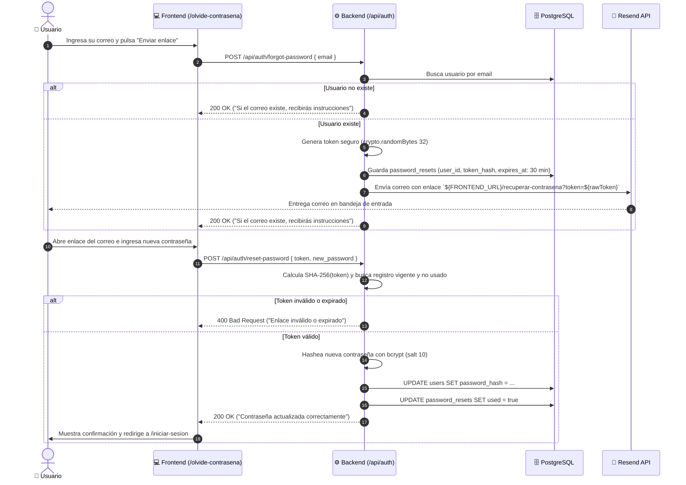
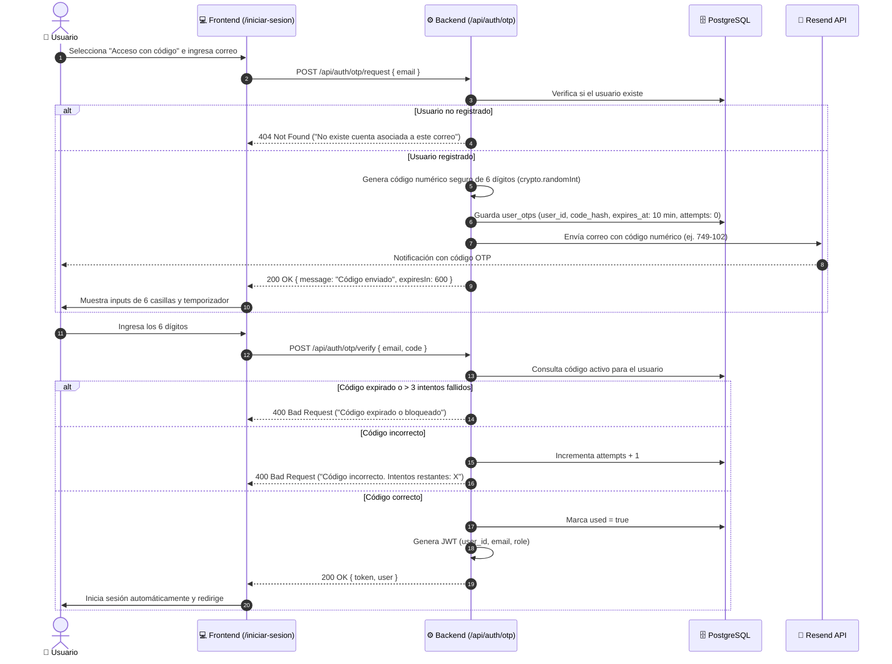
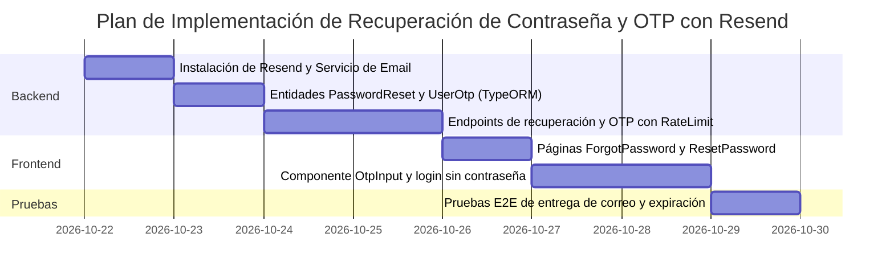

# 🔐 Plan de Implementación: Recuperación de Contraseña y Acceso OTP con Resend
## Proyecto: Disc Market (Backend & Frontend)

Este documento detalla la arquitectura, el modelo de datos, la seguridad criptográfica, las plantillas de correo y el plan de implementación paso a paso para integrar el **Servicio de Recuperación de Contraseña** y el **Inicio de Sesión sin Contraseña con Código OTP (One-Time Password)** utilizando **Resend** como proveedor de correo transaccional.

---

## 📑 Tabla de Contenidos
1. [Arquitectura General y Proveedor (Resend)](#-1-arquitectura-general-y-proveedor-resend)
2. [Diagramas de Flujo y Secuencia](#-2-diagramas-de-flujo-y-secuencia)
3. [Modelo de Datos en PostgreSQL (TypeORM)](#-3-modelo-de-datos-en-postgresql-typeorm)
4. [Seguridad y Mitigación de Vulnerabilidades](#-4-seguridad-y-mitigación-de-vulnerabilidades)
5. [Endpoints de la API REST (Backend)](#-5-endpoints-de-la-api-rest-backend)
6. [Diseño de Interfaces y Experiencia de Usuario (Frontend)](#-6-diseño-de-interfaces-y-experiencia-de-usuario-frontend)
7. [Diseño de Plantillas de Correo Electrónico](#-7-diseño-de-plantillas-de-correo-electrónico)
8. [Fases de Ejecución Paso a Paso](#-8-fases-de-ejecución-paso-a-paso)

---

## 🏛️ 1. Arquitectura General y Proveedor (Resend)

Se utilizará **Resend** vía su SDK oficial (`npm i resend`) por las siguientes ventajas clave sobre SMTP tradicional:
* **Protocolo HTTP REST:** Comunicación rápida (latencia < 200 ms) sin problemas de conexión persistente o timeouts en entornos serverless/contenedores.
* **Entregabilidad a Bandeja de Entrada (Inbox):** Resend gestiona la reputación de IPs y configuración automática de DKIM, SPF y DMARC, evitando que los correos caigan en Spam.
* **Seguridad por Tokens Hashed:** Los tokens y códigos generados en el backend nunca se almacenan en texto plano en la base de datos; se persisten únicamente como hashes **SHA-256**.

### Variables de Entorno Requeridas

#### Backend (`disc-market-backend/.env`):
```env
RESEND_API_KEY=re_123456789_abcdef...
EMAIL_FROM="Disc Market <onboarding@resend.dev>"
FRONTEND_URL="http://localhost:5173"
OTP_EXPIRATION_MINUTES=10
PASSWORD_RESET_EXPIRATION_MINUTES=30
```

#### Frontend (`disc-market-frontend/.env`):
*(Sin variables adicionales; consume los endpoints REST `/api/auth/*` existentes).*

---

## 🔄 2. Diagramas de Flujo y Secuencia

### 2.1. Flujo de Recuperación de Contraseña (Password Reset)



---

### 2.2. Flujo de Inicio de Sesión sin Contraseña (Email OTP)



---

## 🗄️ 3. Modelo de Datos en PostgreSQL (TypeORM)

Se incorporarán dos nuevas entidades relacionales en `src/entities/`:

### 3.1. Entidad `PasswordReset` (`password_resets`)
```sql
CREATE TABLE password_resets (
    reset_id SERIAL PRIMARY KEY,
    user_id INT NOT NULL REFERENCES users(user_id) ON DELETE CASCADE,
    token_hash VARCHAR(64) NOT NULL,
    expires_at TIMESTAMP NOT NULL,
    used BOOLEAN DEFAULT FALSE,
    created_at TIMESTAMP DEFAULT CURRENT_TIMESTAMP
);
CREATE INDEX idx_password_resets_hash ON password_resets(token_hash);
```

### 3.2. Entidad `UserOtp` (`user_otps`)
```sql
CREATE TABLE user_otps (
    otp_id SERIAL PRIMARY KEY,
    user_id INT NOT NULL REFERENCES users(user_id) ON DELETE CASCADE,
    code_hash VARCHAR(64) NOT NULL,
    purpose VARCHAR(20) DEFAULT 'login', -- 'login', 'verify_email', 'sensitive_action'
    attempts INT DEFAULT 0,
    max_attempts INT DEFAULT 3,
    expires_at TIMESTAMP NOT NULL,
    used BOOLEAN DEFAULT FALSE,
    created_at TIMESTAMP DEFAULT CURRENT_TIMESTAMP
);
CREATE INDEX idx_user_otps_active ON user_otps(user_id, used, expires_at);
```

---

## 🛡️ 4. Seguridad y Mitigación de Vulnerabilidades

1. **Protección contra Fuerza Bruta (Brute Force):**
   * El código OTP permite un máximo de **3 intentos fallidos**. Al 3er error, el código se invalida y se exige solicitar uno nuevo.
   * Integración de `express-rate-limit`:
     * Solicitud de OTP: máximo 3 peticiones por IP/correo cada 15 minutos.
     * Verificación de OTP: máximo 5 intentos por IP cada 15 minutos.
     * Solicitud de reseteo: máximo 3 peticiones por IP cada 30 minutos.
2. **Prevención de Enumeración de Usuarios (User Enumeration):**
   * `POST /api/auth/forgot-password` siempre responde con código `200 OK` y el mismo mensaje sin importar si el email está registrado o no en el sistema.
3. **Almacenamiento Criptográfico Seguro:**
   * Los tokens de URL y códigos numéricos **nunca** se guardan en texto plano en la base de datos; se calcula su hash `SHA-256` antes de persistirlos. Si la base de datos sufriera una fuga, los atacantes no podrían usar los códigos.
4. **Invalidación Inmediata (Single-Use):**
   * En cuanto un token de recuperación o código OTP es verificado satisfactoriamente, se marca inmediatamente con `used = true` dentro de una transacción.

---

## ⚙️ 5. Endpoints de la API REST (Backend)

| Método | Endpoint | Middleware | Body de Petición | Respuesta Exitosa |
| :--- | :--- | :--- | :--- | :--- |
| `POST` | `/api/auth/forgot-password` | RateLimit | `{ "email": "usuario@ejemplo.com" }` | `200 OK` `{ "message": "Si el correo está registrado, se enviará un enlace de recuperación." }` |
| `POST` | `/api/auth/reset-password` | RateLimit | `{ "token": "raw_hex...", "new_password": "NuevoPassword123!" }` | `200 OK` `{ "message": "Contraseña restablecida exitosamente." }` |
| `POST` | `/api/auth/otp/request` | RateLimit | `{ "email": "usuario@ejemplo.com" }` | `200 OK` `{ "message": "Código de 6 dígitos enviado.", "expiresIn": 600 }` |
| `POST` | `/api/auth/otp/verify` | RateLimit | `{ "email": "usuario@ejemplo.com", "code": "749102" }` | `200 OK` `{ "token": "jwt...", "user": { ... } }` |

---

## 💻 6. Diseño de Interfaces y Experiencia de Usuario (Frontend)

### 6.1. Pantalla de Login Dual ([`LoginPage.tsx`](../disc-market-frontend/src/features/auth/LoginPage.tsx))
* Selector en la parte superior del formulario:
  * **Opción 1:** "Contraseña habitual" (formulario clásico con email y password).
  * **Opción 2:** "Código temporal por correo (OTP)" (acceso ágil sin recordar contraseña).
* Enlace accesible abajo: *"¿Olvidaste tu contraseña?"* que dirige a `/olvide-contrasena`.

### 6.2. Vista de Solicitud de Reseteo (`ForgotPasswordPage.tsx` - `/olvide-contrasena`)
* Formulario minimalista con campo de correo electrónico y botón *"Enviar instrucciones de recuperación"*.
* Banner de confirmación: *"Te enviamos un enlace de recuperación. Revisa tu bandeja de entrada o spam."*
* Botón de retorno al inicio de sesión.

### 6.3. Vista de Restablecimiento (`ResetPasswordPage.tsx` - `/recuperar-contrasena`)
* Captura el token del query param de la URL (`?token=...`).
* Campos de "Nueva Contraseña" y "Confirmar Contraseña".
* Medidor interactivo de fortaleza de contraseña en tiempo real (mismo diseño visual utilizado en la pestaña de Seguridad de `/perfil`).
* Mensajes claros si el enlace expiró o es inválido, con botón para solicitar uno nuevo.

### 6.4. Componente de Entrada OTP (`OtpInput.tsx`)
* 6 inputs numéricos de un solo dígito con estilo visual de vinilo.
* Auto-focus automático: al escribir en la primera casilla, salta automáticamente a la siguiente. Soporte para pegar los 6 dígitos juntos (`onPaste`).
* Cuenta regresiva visible: *"¿No recibiste el código? Podrás solicitar otro en 00:45"*.

---

## 🎨 7. Diseño de Plantillas de Correo Electrónico

Los correos mantendrán la identidad visual oscura y elegante de **Disc Market**:
* **Fondo:** `#12110f` (Ink profundo) y tarjeta contenedora `#1b1915`.
* **Detalles y botones:** Acento ámbar `#e8a23a` con tipografía clara y limpia.
* **Encabezado:** Logotipo *"DiscMarket · Vinyl & CD Atelier"*.
* **Seguridad:** Advertencia legal: *"Si tú no solicitaste este cambio, puedes ignorar este correo. Tu cuenta permanece segura."*

### 7.1. Plantilla para Código OTP
```html
<div style="background-color: #12110f; padding: 40px 20px; font-family: sans-serif; color: #f3eee4;">
  <div style="max-width: 480px; margin: 0 auto; background-color: #1b1915; border: 1px solid #3c362e; border-radius: 20px; padding: 32px; text-align: center;">
    <h1 style="color: #e8a23a; font-size: 24px; margin-bottom: 8px;">DiscMarket</h1>
    <p style="color: #b7afa3; font-size: 14px; margin-top: 0;">Tu atelier de vinilos y CDs</p>
    
    <div style="margin: 32px 0;">
      <p style="font-size: 16px; margin-bottom: 12px;">Tu código de acceso temporal es:</p>
      <div style="display: inline-block; background-color: #12110f; border: 2px dashed #e8a23a; border-radius: 12px; padding: 14px 28px; font-size: 32px; font-weight: bold; letter-spacing: 6px; color: #e8a23a;">
        {{CODE}}
      </div>
      <p style="color: #b7afa3; font-size: 12px; margin-top: 12px;">Válido únicamente durante los próximos 10 minutos.</p>
    </div>
    
    <hr style="border: none; border-top: 1px solid #3c362e; margin: 24px 0;" />
    <p style="color: #b7afa3; font-size: 11px;">Si no solicitaste este código, ignora este mensaje.</p>
  </div>
</div>
```

---

## 📅 8. Fases de Ejecución Paso a Paso



| Fase | Componente | Descripción de Tareas |
| :---: | :--- | :--- |
| **Fase 1** | **Resend Mail Service** | Instalar `resend` en el backend. Crear helper modular `src/services/mail.service.ts` con funciones `sendPasswordResetEmail(to, token)` y `sendOtpEmail(to, code)`. |
| **Fase 2** | **Persistencia TypeORM** | Crear entidades `PasswordReset.ts` y `UserOtp.ts`, registrar en `data-source.ts` y verificar sincronización de tablas en PostgreSQL. |
| **Fase 3** | **Controladores y Seguridad** | Crear controlador `authRecovery.controller.ts` con hashing SHA-256 de tokens y protección con `express-rate-limit`. |
| **Fase 4** | **Vistas y UX en Frontend** | Crear páginas `/olvide-contrasena`, `/recuperar-contrasena` y selector OTP en `/iniciar-sesion`. Crear servicio `authRecoveryService.ts`. |
| **Fase 5** | **Validación y Pruebas** | Probar solicitud de códigos, reseteo de claves reales, límites de tiempo de expiración y bloqueo tras 3 intentos fallidos. |
