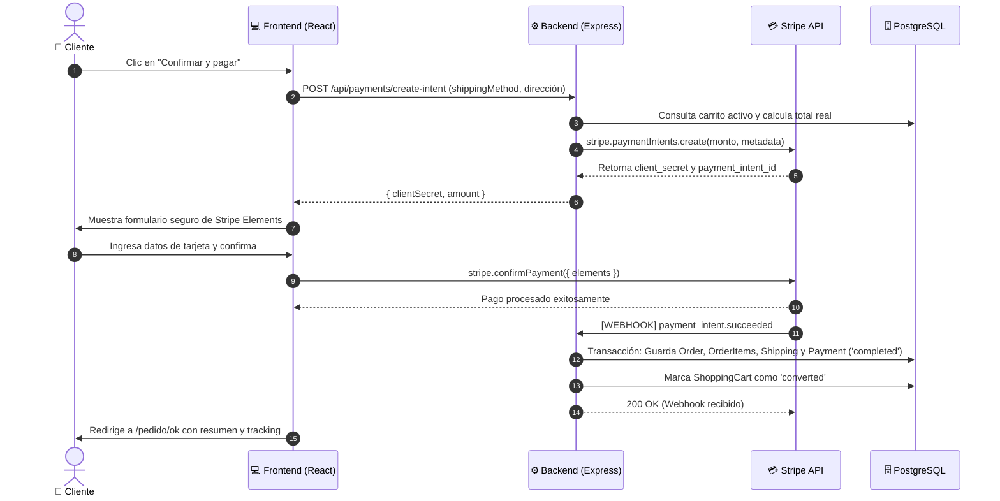

# 💳 Plan de Integración de Pasarela de Pagos (Stripe) - Disc Market

Este documento detalla la arquitectura, el flujo de datos y el plan de implementación paso a paso para integrar pagos con **Stripe** en **Disc Market** (`disc-market-backend` y `disc-market-frontend`) en la rama `feat/payment-transactions`.

---

## 🏛️ 1. Arquitectura y Enfoque

Se utilizará el modelo estándar y seguro de la industria: **Stripe Elements (Embedded Payment Form)** con **Payment Intents** y **Webhooks**.

* **Seguridad (PCI-DSS):** Los datos sensibles de tarjetas nunca tocan nuestros servidores; viajan encriptados directamente entre el navegador del cliente y la infraestructura de Stripe.
* **Experiencia de Usuario (UX):** El usuario no es redirigido fuera de Disc Market; el formulario de pago se renderiza dentro del sitio con el tema visual oscuro (`theme: 'night'`).
* **Confiabilidad:** La confirmación y creación de la orden se realiza de servidor a servidor mediante un **Webhook**, protegiendo la venta incluso si el usuario cierra su navegador tras pagar.

### Diagrama de Secuencia



---

## 📋 2. Fases de Implementación

### Fase 1: Credenciales y Variables de Entorno

1. **Dashboard de Stripe:**
   * Iniciar sesión en modo Test: [https://dashboard.stripe.com/test](https://dashboard.stripe.com/test)
   * Obtener `Publishable Key` (`pk_test_...`) y `Secret Key` (`sk_test_...`).
2. **Backend (`disc-market-backend/.env`):**
   ```env
   STRIPE_SECRET_KEY=sk_test_...
   STRIPE_WEBHOOK_SECRET=whsec_...
   ```
3. **Frontend (`disc-market-frontend/.env`):**
   ```env
   VITE_STRIPE_PUBLISHABLE_KEY=pk_test_...
   ```

---

### Fase 2: Backend (`disc-market-backend`)

#### 2.1. Dependencias
```bash
npm install stripe
```

#### 2.2. Actualización de Entidad `Payment` (`src/entities/Payment.ts`)
Agregar campos para trazabilidad:
* `transaction_id`: Almacena el `pi_...` (Payment Intent ID) devuelto por Stripe.
* `receipt_url`: Enlace al comprobante digital generado por Stripe (opcional).

#### 2.3. Soporte de Webhooks en `src/app.ts`
El validador de firmas criptográficas de Stripe requiere el cuerpo en crudo (*raw buffer*).
* Configurar middleware `express.raw({ type: 'application/json' })` exclusivamente para la ruta `/api/payments/webhook` antes del `express.json()` global.

#### 2.4. Controlador y Rutas (`src/controllers/payment.controller.ts` y `src/routes/payment.routes.ts`)
* **`POST /api/payments/create-intent`**:
  * Autenticación obligatoria con `verifyToken`.
  * Busca el carrito activo (`ShoppingCart`) del usuario.
  * Valida que haya stock y calcula el monto total en centavos (`amount * 100`).
  * Crea el `paymentIntent` asociando en los `metadata`: `userId`, `cartId`, `shippingMethod`, etc.
  * Devuelve `{ clientSecret, amount, currency }`.

* **`POST /api/payments/webhook`**:
  * Valida la firma del evento con `stripe.webhooks.constructEvent`.
  * Escucha `payment_intent.succeeded`:
    * Extrae la metadata (`userId`, `cartId`).
    * Abre una transacción en TypeORM.
    * Crea `Order` y sus `OrderItem`.
    * Crea el registro `Payment` con `payment_status: 'completed'` y `transaction_id`.
    * Crea el registro `Shipping` con `tracking_number`.
    * Actualiza `ShoppingCart` a `status: 'converted'`.
    * Confirma la transacción.
  * Escucha `payment_intent.payment_failed`:
    * Registra el intento fallido o notifica en logs.

---

### Fase 3: Frontend (`disc-market-frontend`)

#### 3.1. Dependencias
```bash
npm install @stripe/stripe-js @stripe/react-stripe-js
```

#### 3.2. Carga del SDK de Stripe
* Crear `src/shared/lib/stripe.ts`:
  ```typescript
  import { loadStripe } from '@stripe/stripe-js';
  export const stripePromise = loadStripe(import.meta.env.VITE_STRIPE_PUBLISHABLE_KEY);
  ```

#### 3.3. Componente de Formulario de Pago
* Crear `src/features/cart/components/StripePaymentModal.tsx` o formulario embebido:
  * Utiliza `<Elements stripe={stripePromise} options={{ clientSecret, appearance: { theme: 'night' } }}>`.
  * Componente `<PaymentElement />` oficial de Stripe (soporta Tarjetas, Google Pay, Apple Pay).
  * Botón para ejecutar `stripe.confirmPayment()`.

#### 3.4. Actualización de `CartPage.tsx`
* En lugar de llamar directamente a `orderService.checkout()`, el botón de pagar solicita primero la intención (`create-intent`).
* Abre el formulario/modal de Stripe Elements.
* Al confirmarse el pago:
  * Limpia el estado local del carrito (`clear()`).
  * Redirige a `/pedido/ok` pasando los datos del pedido y número de rastreo.

---

### Fase 4: Pruebas y Sandbox

1. **Stripe CLI para Webhooks locales:**
   * Instalar la CLI de Stripe para reenviar eventos al backend de desarrollo:
     ```bash
     stripe listen --forward-to localhost:5000/api/payments/webhook
     ```
2. **Tarjetas de Prueba Oficiales:**
   * Éxito directo: `4242 4242 4242 4242` (cualquier fecha futura y CVC).
   * Autenticación 3D Secure obligatoria: `4000 0027 6000 3184`.
   * Fondos insuficientes: `4000 0000 0000 9995`.
3. **Validación en Base de Datos:**
   * Verificar en PostgreSQL que se inserten las filas en `orders`, `order_items`, `payments` y `shipping`.

---

## 📌 Checklist de Tareas

- [x] **Fase 1:** Obtener claves de Stripe y configurar `.env` en ambos repos.
- [x] **Fase 2.1:** Instalar `stripe` en `disc-market-backend`.
- [x] **Fase 2.2:** Modificar `Payment.ts` para agregar `transaction_id`.
- [x] **Fase 2.3:** Configurar raw body middleware en `app.ts`.
- [x] **Fase 2.4:** Crear `payment.controller.ts` (`create-intent`, `confirm` y `webhook`).
- [x] **Fase 2.5:** Registrar rutas en `payment.routes.ts` y montarlas en `apiRoutes`.
- [x] **Fase 3.1:** Instalar `@stripe/stripe-js` y `@stripe/react-stripe-js` en `disc-market-frontend`.
- [x] **Fase 3.2:** Crear servicio de pagos en frontend (`paymentService.ts`).
- [x] **Fase 3.3:** Crear componente de checkout con Stripe Elements y tema `night` (`StripeCheckoutModal.tsx`).
- [x] **Fase 3.4:** Conectar flujo en `CartPage.tsx` y redirigir a `OrderOkPage`.
- [ ] **Fase 4:** Realizar pruebas de flujo completo y verificar en PostgreSQL y Stripe Dashboard.
