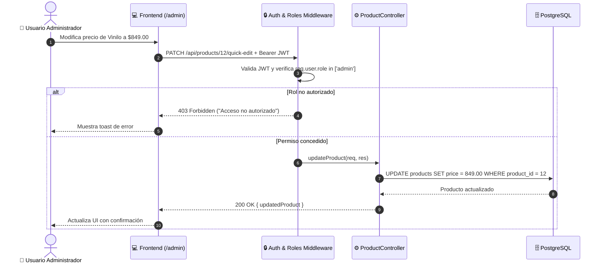
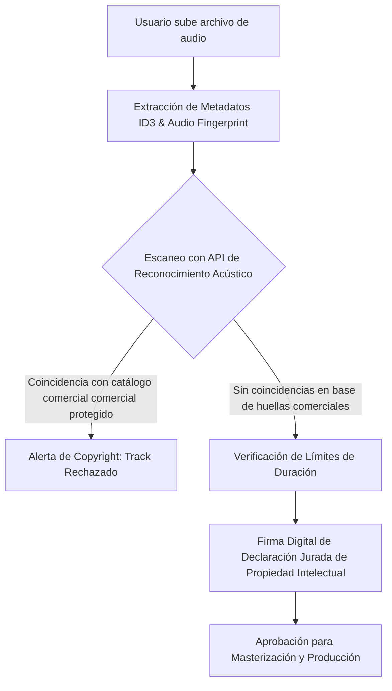
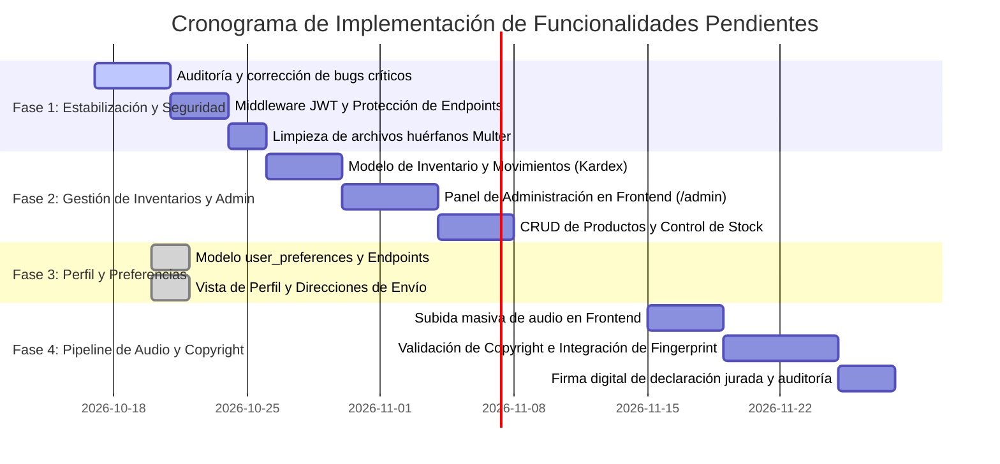

# 📋 Especificación de Funcionalidades Pendientes y Hoja de Ruta (Roadmap)
## Proyecto: Disc Market (Backend & Frontend)

Este documento detalla la arquitectura, modelo de datos, endpoints de API, diseño de interfaces y plan técnico para la implementación de las funcionalidades pendientes y correcciones del sistema **Disc Market**.

---

## 📑 Tabla de Contenidos
1. [Módulo 1: Control de Acceso y Usuario Administrador (RBAC)](#-módulo-1-control-de-acceso-y-usuario-administrador-rbac)
2. [Módulo 2: Configuraciones de Usuario y Preferencias](#-módulo-2-configuraciones-de-usuario-y-preferencias)
3. [Módulo 3: Subida de Audios y Validación de Copyright](#-módulo-3-subida-de-audios-y-validación-de-copyright)
4. [Módulo 4: Gestión Integral de Inventarios](#-módulo-4-gestión-integral-de-inventarios)
5. [Módulo 5: Corrección de Errores y Bugs de la Aplicación](#-módulo-5-corrección-de-errores-y-bugs-de-la-aplicación)
6. [Matriz de Priorización y Fases de Entrega](#-matriz-de-priorización-y-fases-de-entrega)

---

## 🛡️ Módulo 1: Control de Acceso y Usuario Administrador (RBAC)

### 1.1. Contexto y Necesidad
Actualmente, el sistema registra usuarios con un rol por defecto (`customer`) en la tabla `users`, pero los endpoints para crear productos (`POST /api/products`) carecen de validación de identidad y permisos. Se requiere un esquema formal de **Role-Based Access Control (RBAC)** que distinga entre clientes (`customer`), administradores de plataforma (`admin`) y operadores de catálogo (`inventory_manager`).

### 1.2. Matriz de Permisos
| Acción / Endpoint | `customer` | `inventory_manager` | `admin` |
| :--- | :---: | :---: | :---: |
| Explorar catálogo y reproducir previews | ✅ | ✅ | ✅ |
| Crear y comprar discos personalizados | ✅ | ✅ | ✅ |
| Consultar perfil y compras propias | ✅ | ✅ | ✅ |
| Crear nuevos productos en catálogo | ❌ | ✅ | ✅ |
| Modificar precios, nombres y descripciones | ❌ | ✅ | ✅ |
| Ajustar existencias y niveles de stock | ❌ | ✅ | ✅ |
| Eliminar o archivar productos del catálogo | ❌ | ❌ | ✅ |
| Promover usuarios o reasignar roles | ❌ | ❌ | ✅ |
| Consultar métricas financieras y órdenes globales | ❌ | ❌ | ✅ |

### 1.3. Arquitectura Técnica en Backend
1. **Middlewares de Seguridad:**
   * `auth.middleware.ts`: Extrae el header `Authorization: Bearer <token>`, valida la firma criptográfica con `JWT_SECRET` y vincula `req.user = decodedToken`.
   * `roles.middleware.ts`: Función generadora de orden superior (`requireRole(['admin', 'inventory_manager'])`) que verifica si el usuario autenticado tiene el privilegio requerido; responde `403 Forbidden` si no lo tiene.
2. **Nuevos Endpoints de Administración de Catálogo:**
   * `PUT /api/products/:id`: Edición completa de datos del producto (título, artista, formato, precio, descripción, categoría, carátula).
   * `PATCH /api/products/:id/quick-edit`: Edición parcial rápida (únicamente precio y descripción).
   * `DELETE /api/products/:id`: Eliminación lógica o física (borrado seguro verificando si existen órdenes asociadas).
   * `PATCH /api/users/:id/role`: Asignación de rol a un usuario (exclusivo para `admin`).

### 1.4. Interfaz de Usuario en Frontend
* **Ruta protegida `/admin`:**
  * Componente `AdminGuard` que valida si `user?.role === 'admin'`. Redirige a `/` con toast de advertencia si no tiene privilegios.
* **Panel de Gestión de Catálogo (`/admin/productos`):**
  * Tabla con buscador en tiempo real, filtros por formato, stock y estado.
  * Botón para dar de alta nuevo producto con modal o vista dedicada (`ProductFormModal`).
  * Edición inline de precio y descripción.
  * Botón de borrado con modal de confirmación irreversible.



---

## ⚙️ Módulo 2: Configuraciones de Usuario y Preferencias ✅ (Completado / Implementado)

> **Estado:** ✅ **COMPLETADO (Octubre 2026)**
>
> **Artefactos implementados:**
> * **Backend:**
>   * Entidad TypeORM: [`UserPreference.ts`](./src/entities/UserPreference.ts) (relación 1:1 con `User`).
>   * Controlador: [`user.controller.ts`](./src/controllers/user.controller.ts) con métodos `getProfile`, `updateProfile`, `updatePassword`, `updatePreferences` y `getUserOrders`.
>   * Rutas: [`user.routes.ts`](./src/routes/user.routes.ts) protegidas con `authenticateToken` bajo `/api/users`.
> * **Frontend:**
>   * Servicios API: [`userService.ts`](../disc-market-frontend/src/shared/api/services/userService.ts) y contratos en [`types.ts`](../disc-market-frontend/src/shared/api/types.ts).
>   * Vista Principal: [`ProfilePage.tsx`](../disc-market-frontend/src/features/profile/ProfilePage.tsx) con soporte para 5 pestañas de configuración.
>   * Pestañas Modulares: [`PersonalInfoTab.tsx`](../disc-market-frontend/src/features/profile/components/PersonalInfoTab.tsx), [`ShippingAddressTab.tsx`](../disc-market-frontend/src/features/profile/components/ShippingAddressTab.tsx), [`PreferencesTab.tsx`](../disc-market-frontend/src/features/profile/components/PreferencesTab.tsx), [`SecurityTab.tsx`](../disc-market-frontend/src/features/profile/components/SecurityTab.tsx), y [`OrderHistoryTab.tsx`](../disc-market-frontend/src/features/profile/components/OrderHistoryTab.tsx).
>   * Integración en Checkout: [`CartPage.tsx`](../disc-market-frontend/src/features/cart/CartPage.tsx) con autocompletado de la dirección por defecto guardada.

### 2.1. Contexto y Necesidad
La experiencia de usuario previa no permitía actualizar datos personales, gestionar direcciones de entrega guardadas, modificar la contraseña ni configurar preferencias de la plataforma.

### 2.2. Modelo de Datos Implementado
Se persistió mediante la tabla relacional `user_preferences` conectada en relación 1:1 con `users`:

```sql
CREATE TABLE user_preferences (
    preference_id SERIAL PRIMARY KEY,
    user_id INT UNIQUE REFERENCES users(user_id) ON DELETE CASCADE,
    phone VARCHAR(20),
    preferred_format VARCHAR(10) DEFAULT 'ALL', -- 'VINYL', 'CD', 'ALL'
    theme VARCHAR(20) DEFAULT 'dark',            -- 'dark', 'light', 'high-contrast'
    notify_order_status BOOLEAN DEFAULT TRUE,
    notify_newsletter BOOLEAN DEFAULT FALSE,
    default_address_line1 VARCHAR(255),
    default_address_line2 VARCHAR(255),
    default_city VARCHAR(100),
    default_state VARCHAR(100),
    default_postal_code VARCHAR(20),
    default_country VARCHAR(100) DEFAULT 'México',
    avatar_url VARCHAR(500),
    updated_at TIMESTAMP DEFAULT CURRENT_TIMESTAMP
);
```

### 2.3. Endpoints Implementados
* [x] `GET /api/users/profile`: Devuelve el perfil del usuario autenticado, sus preferencias y estadísticas de compras (total gastado, conteo de pedidos y última orden).
* [x] `PUT /api/users/profile`: Actualización de nombre, teléfono y avatar de perfil.
* [x] `PUT /api/users/password`: Cambio seguro de contraseña (valida `current_password` con `bcrypt.compare`, longitud mínima y cifra nuevo hash).
* [x] `PUT /api/users/preferences`: Actualización de dirección de entrega por defecto, tema, formato musical y suscripción a notificaciones.
* [x] `GET /api/users/orders`: Historial completo de órdenes con número de rastreo (`tracking_number`), desglose de ítems estándar y personalizados, y estados de entrega.

### 2.4. Vistas y Componentes Frontend Implementados
* [x] **Ruta `/perfil` (Mi Cuenta):**
  * [x] **Cabecera y Métricas:** Tarjeta con avatar dinámico, rol, fecha de alta y contadores de pedidos e inversión total.
  * [x] **Pestaña 1 - Datos Personales:** Nombre, correo verificado (solo lectura), teléfono y selector de avatares temáticos.
  * [x] **Pestaña 2 - Dirección de Entrega:** Formulario estructurado y vista previa interactiva estilo etiqueta física de paquetería.
  * [x] **Pestaña 3 - Preferencias & Formato:** Selección de formato predilecto (Vinilo/CD/Ambos), tema visual y toggles de alertas.
  * [x] **Pestaña 4 - Seguridad:** Cambio de contraseña con medidor interactivo de fortaleza en tiempo real.
  * [x] **Pestaña 5 - Historial de Pedidos:** Listado de órdenes con badges de estatus, desglose de productos y botón para copiar la guía de rastreo.
  * [x] **Autocompletado en Checkout:** Precarga automática de la dirección guardada en `CartPage.tsx`.

---

## 🎵 Módulo 3: Subida de Audios y Validación de Copyright

### 3.1. Contexto y Necesidad
En el creador de discos personalizados (`/crear`), el paso 2 actualmente solo solicita texto para los nombres de las canciones. La funcionalidad completa requiere:
1. Subida real de archivos de audio por parte del usuario.
2. Validación de duración máxima según la capacidad física del medio.
3. **Mecanismo de validación y control de derechos de autor (Copyright Compliance)** para evitar la fabricación y piratería de fonogramas protegidos comercialmente.

### 3.2. Límites Físicos por Formato
| Formato | Capacidad Máxima | Formatos Soportados | Límite por Archivo |
| :--- | :---: | :---: | :---: |
| **CD (Disco Compacto)** | 74 a 80 minutos totales (hasta 20 pistas) | MP3, WAV, FLAC, AAC | 50 MB por pista |
| **Vinilo (12" LP - 33 RPM)** | 22 minutos por cara (44 min total) | MP3, WAV, FLAC | 75 MB por pista |

### 3.3. Arquitectura de Verificación de Copyright
El control de derechos de autor se abordará con un enfoque de tres capas de defensa:



1. **Capa 1: Huella Acústica Automatizada (Audio Fingerprinting):**
   * Integración con servicio de reconocimiento acústico (ej. **AcoustID / Chromaprint** o **AudD Music API**).
   * Al cargar cada pista, el backend extrae el fingerprint acústico del audio (`fpcalc`) y consulta si coincide con fonogramas comerciales protegidos por discográficas multinacionales (Sony, Universal, Warner, etc.).
   * Si la canción coincide con un track comercial con derechos restringidos de distribución, se marca como `COPYRIGHT_FLAGGED` y se bloquea su manufactura.
2. **Capa 2: Declaración Jurada Legal y Consentimiento de Propiedad:**
   * Cláusula legal obligatoria antes de ordenar el prensado:
     > *"Declaro bajo protesta de decir verdad que soy titular legítimo de los derechos patrimoniales y morales de los audios cargados, o poseo la licencia correspondiente para su reproducción física. Exonero a Disc Market de cualquier reclamo por infracción a la Ley Federal del Derecho de Autor."*
   * El sistema almacena la aceptación con firma digital (timestamp, IP del cliente, ID de usuario y hash SHA-256 de los audios).
3. **Capa 3: Panel de Revisión Administrativa (Auditoría de Producción):**
   * Antes del prensado físico, un operador revisa el reporte del escaneo acústico de las pistas del pedido.

### 3.4. Implementación en Frontend (`CreatePage.tsx`)
* Zona interactiva de subida con Drag & Drop en el paso de "Pistas".
* Reproductor de audio embebido para que el usuario pueda escuchar una previsualización de su propia pista.
* Barra de progreso de subida y badges de estado:
  * 🟢 `Verificado / Original`
  * 🟡 `Analizando derechos...`
  * 🔴 `Conflicto de copyright detectado`
* Indicador de tiempo total acumulado (ejemplo: `32:15 / 44:00 min utilizados`).

---

## 📦 Módulo 4: Gestión Integral de Inventarios

### 4.1. Contexto y Necesidad
Actualmente existe la tabla `inventory` vinculada a `products`, pero solo cuenta con `quantity_available` y `quantity_reserved`, sin registro histórico de movimientos, sin umbrales de reabastecimiento ni alertas de rotura de stock.

### 4.2. Modelo de Datos Ampliado
```sql
-- Extensión de la tabla de inventario existente
ALTER TABLE inventory ADD COLUMN min_threshold INT DEFAULT 5;
ALTER TABLE inventory ADD COLUMN unit_cost DECIMAL(10,2) DEFAULT 0.00;
ALTER TABLE inventory ADD COLUMN aisle_location VARCHAR(50);

-- Tabla histórica de movimientos de inventario (Kardex)
CREATE TABLE inventory_logs (
    log_id SERIAL PRIMARY KEY,
    product_id INT REFERENCES products(product_id) ON DELETE CASCADE,
    movement_type VARCHAR(20) NOT NULL, -- 'PURCHASE', 'SALE', 'RETURN', 'ADJUSTMENT', 'DEFECTIVE'
    quantity_changed INT NOT NULL,       -- Positivo para entradas, negativo para salidas
    previous_quantity INT NOT NULL,
    new_quantity INT NOT NULL,
    reference_order_id INT REFERENCES orders(order_id) ON DELETE SET NULL,
    notes TEXT,
    performed_by INT REFERENCES users(user_id) ON DELETE SET NULL,
    created_at TIMESTAMP DEFAULT CURRENT_TIMESTAMP
);
```

### 4.3. Endpoints de la API de Inventario
* `GET /api/inventory`: Listado general con cálculo de estado (`in_stock`, `low_stock`, `out_of_stock`).
* `POST /api/inventory/adjustment`: Registro de entrada o salida manual de stock con bitácora de auditoría.
* `GET /api/inventory/low-stock`: Reporte de productos que están por debajo del umbral mínimo (`quantity_available <= min_threshold`).
* `GET /api/inventory/logs/:product_id`: Historial detallado de movimientos de un producto.

### 4.4. Prevención de Sobreventa (Race Conditions)
* Al momento de crear la intención de pago en Stripe (`POST /api/payments/create-intent`):
  * Se bloquea el stock temporalmente moviendo `quantity_available` a `quantity_reserved` dentro de una transacción con `SELECT ... FOR UPDATE`.
  * Si el pago es exitoso vía Webhook, `quantity_reserved` se descuenta definitivamente y se genera el registro en `inventory_logs`.
  * Si la sesión de pago expira o falla tras 30 minutos, un job o cron reactiva las unidades reservadas regresándolas a `quantity_available`.

---

## 🐛 Módulo 5: Corrección de Errores y Bugs de la Aplicación

A continuación se detallan los errores, inconsistencias y vulnerabilidades identificadas en el estado actual del repositorio, junto con su respectiva solución:

### 5.1. Seguridad y Autenticación en Endpoints Críticos
* **Diagnóstico:** Rutas como `POST /api/products`, `POST /api/custom-products` y consultas de órdenes no validan el token JWT del usuario, permitiendo que clientes anónimos puedan publicar productos o enviar carritos sin sesión real.
* **Solución:**
  * Implementar middleware `authenticateToken` en todas las rutas protegidas.
  * Inyectar el `user_id` desde el token verificado (`req.user.user_id`) en lugar de confiar en el cuerpo de la petición (`req.body.user_id`), impidiendo la suplantación de identidad.

### 5.2. Desfase de Precios Hardcodeados en Creación Personalizada
* **Diagnóstico:** En `customProduct.controller.ts` y en `CreatePage.tsx`, el precio base del disco personalizado está fijado con valores en código (`Vinyl = $799.00`, `CD = $99.00`). Si el administrador altera los precios en la base de datos, el cálculo del checkout queda inconsistente.
* **Solución:**
  * Crear un endpoint de configuración o tarifas base `GET /api/custom-products/pricing` que consulte directamente los precios vigentes desde la tabla de productos o configuración del sistema.

### 5.3. Limpieza de Archivos Huérfanos en Multer ante Errores de Base de Datos
* **Diagnóstico:** Cuando un usuario sube una portada (`uploadCover`) o pistas (`uploadTracks`) y la inserción subsiguiente en PostgreSQL falla por error de clave foránea o validación, los archivos ya fueron guardados en el disco en `uploads/covers/` o `uploads/tracks/`, generando acumulación de basura y consumo innecesario de almacenamiento.
* **Solución:**
  * Envolver la operación en un bloque `try/catch` con rollback de archivos: si `save()` arroja una excepción, invocar `fs.promises.unlink()` sobre los archivos subidos en la petición actual.

### 5.4. Sincronización del Carrito Dual (Local vs. Servidor)
* **Diagnóstico:** En `CartContext.tsx`, si la llamada al backend falla por problemas de conexión intermitente, el estado local no reintenta sincronizarse al volver la conexión, provocando discrepancias entre lo que el usuario ve en pantalla y lo que Stripe cobra (ya que Stripe valida el carrito de la base de datos).
* **Solución:**
  * Implementar una cola de sincronización con reintento automático y un banner visual en el carrito advirtiendo si hay cambios locales pendientes de sincronizar con el servidor.

### 5.5. Manejo del Pool de Conexiones de PostgreSQL (TypeORM)
* **Diagnóstico:** La inicialización de `AppDataSource` no cuenta con política de reintentos exponenciales en caso de que el contenedor de PostgreSQL tarde en estar disponible tras reiniciar `docker-compose`.
* **Solución:**
  * Añadir función de conexión recursiva con hasta 5 reintentos y retardo progresivo (backoff exponencial) antes de abortar el arranque de la API.

### 5.6. Sanitización y Validación de Tipos MIME en Archivos
* **Diagnóstico:** El filtro de Multer en `upload.middleware.ts` valida la extensión y el `file.mimetype` reportado por el cliente, pero no analiza los Magic Bytes del archivo real, abriendo riesgo de subida de ejecutables camuflados.
* **Solución:**
  * Utilizar una librería como `file-type` para verificar la cabecera binaria real del archivo antes de persistirlo definitivamente.

---

## 📅 Matriz de Priorización y Fases de Entrega



| Prioridad | Módulo / Funcionalidad | Impacto en Negocio | Esfuerzo Técnico | Estado |
| :---: | :--- | :---: | :---: | :---: |
| 🔴 **P0 (Crítico)** | Corrección de bugs de seguridad, middlewares JWT y control RBAC | Alto (Seguridad / Integridad) | Medio | ⏳ Pendiente |
| 🔴 **P0 (Crítico)** | Gestión de Inventarios (Control de existencias y prevención de sobreventa) | Alto (Operación comercial) | Medio-Alto | ⏳ Pendiente |
| 🟡 **P1 (Alto)** | Panel de Usuario Administrador (CRUD de productos y precios) | Alto (Autonomía de negocio) | Medio | ⏳ Pendiente |
| 🟡 **P1 (Alto)** | Subida de pistas de audio y validación de copyright | Alto (Funcionalidad core personalizada) | Alto | ⏳ Pendiente |
| 🟢 **P2 (Medio)** | Configuraciones de usuario, preferencias y direcciones guardadas | Medio (Experiencia de usuario / Fidelización) | Bajo-Medio | ✅ **Completado** |
