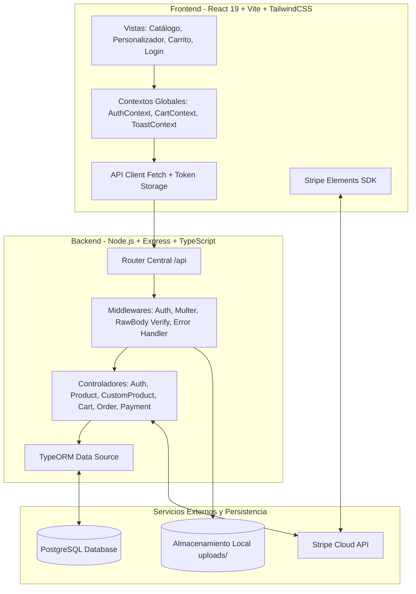
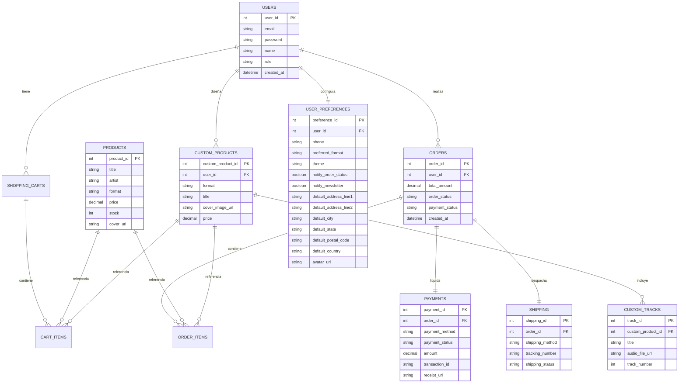

# 💿 Documentación Técnica del Sistema: Disc Market

**Disc Market** es una plataforma integral de comercio electrónico enfocada en la venta y personalización de música en formatos físicos (**CDs** y **Vinilos**). Permite explorar catálogos existentes, reproducir muestras de audio, personalizar producciones propias (subiendo portadas y pistas de audio originales) y procesar pagos de forma segura mediante **Stripe**.

---

## 🏛️ 1. Arquitectura General del Sistema

El sistema sigue una arquitectura cliente-servidor desacoplada basada en servicios RESTful y micro-componentes:

---

## 📦 2. Módulos y Funcionalidades del Sistema

### 🔐 2.1. Módulo de Autenticación y Usuarios
* **Registro de Usuarios (`POST /api/auth/register`):**
  * Validación de correo electrónico único.
  * Cifrado unidireccional de contraseñas mediante **`bcrypt`** con factor de costo (salt rounds = 10).
  * Creación automática de perfil en la tabla `users`.
* **Inicio de Sesión (`POST /api/auth/login`):**
  * Verificación de credenciales comparando hashes con `bcrypt.compare`.
  * Generación de **JSON Web Token (JWT)** firmado con clave secreta y tiempo de expiración (24h).
  * Persistencia segura del token en `localStorage` en el cliente.
* **Control de Sesión en Frontend:**
  * `AuthContext` provee el estado global del usuario logueado en toda la aplicación.

---

### 🎵 2.2. Módulo de Catálogo de Productos
* **Exploración y Filtrado (`GET /api/products`):**
  * Listado de discos prediseñados y álbumes de colección.
  * Filtros dinámicos por formato: `vinyl` (Vinilos) y `cd` (Discos compactos).
  * Filtros por género musical (Rock, Jazz, Pop, Metal, Electrónica, etc.).
  * Búsqueda por texto (título de álbum o artista).
* **Detalle de Producto (`GET /api/products/:id`):**
  * Vista individual con precio, descripción, stock disponible, año de lanzamiento y tracklist.
* **Creación de Productos (`POST /api/products`):**
  * Endpoint administrativo para dar de alta nuevos títulos en el catálogo.

---

### 🎨 2.3. Módulo de Personalización de Discos (Custom Products)
Una de las funcionalidades insignia de la plataforma: permite a creadores independientes armar su propia edición física.
* **Diseño del Disco (`POST /api/custom-products`):**
  * Selección de formato físico (`vinyl` o `cd`).
  * Asignación de título del proyecto y especificaciones de tiraje.
  * **Subida de carátula (`uploadCover.single('cover')`):** Procesa archivos de imagen con Multer validando tipo MIME (`image/jpeg`, `image/png`, `image/webp`) y límite de 5MB.
* **Carga de Pistas de Audio (`POST /api/custom-products/:id/tracks`):**
  * **Subida masiva de audio (`uploadTracks.array('tracks', 20)`):** Permite subir hasta 20 canciones en formatos de audio (`audio/mpeg`, `audio/wav`, `audio/flac`, etc.) con un límite de hasta 50MB por archivo.
  * Guarda la metadata del track (título, duración estimada, número de pista).
* **Cálculo de Precios Dinámico:**
  * El sistema calcula el precio final del producto personalizado con base en el formato base seleccionado más la cantidad de pistas añadidas.

---

### 🛒 2.4. Módulo de Carrito de Compras
* **Persistencia Dual (BD + Local):**
  * Para usuarios registrados, el carrito se sincroniza con PostgreSQL (`shopping_carts` y `cart_items`), permitiendo que no se pierdan los productos al recargar o cambiar de dispositivo.
  * Relación polimórfica en `cart_items`: un ítem puede referenciar un producto del catálogo (`product_id`) O una pieza personalizada (`custom_product_id`).
* **Operaciones Soportadas:**
  * `GET /api/cart/user/:user_id`: Obtiene el carrito activo con los detalles y precios vigentes.
  * `POST /api/cart/items`: Agrega o incrementa la cantidad de un producto.
  * `DELETE /api/cart/items/:item_id`: Remueve una línea del carrito.
  * Control de cantidades (1 a 10 piezas por ítem).

---

### 💳 2.5. Módulo de Pasarela de Pagos (Stripe)
Implementación bajo el estándar **PCI-DSS Compliant** usando **Stripe Elements** y **Payment Intents**:
* **Creación de Intención (`POST /api/payments/create-intent`):**
  * El servidor calcula el monto exacto desde el carrito activo en la base de datos (evitando que el frontend altere el precio maliciosamente).
  * Se comunica con la API de Stripe y retorna un `clientSecret`.
* **Formulario Embebido (`StripeCheckoutModal.tsx`):**
  * Renderiza componentes oficiales de tarjeta y métodos rápidos (Google Pay, Apple Pay, Link).
  * Interfaz optimizada con tema oscuro (`theme: 'night'`), altura máxima (`max-h-[90vh]`) y scroll interno.
* **Confirmación Inmediata (`POST /api/payments/confirm`):**
  * Verifica el estado exitoso (`succeeded`) del PaymentIntent directo con Stripe.
  * Consolida la orden y genera el número de rastreo.
* **Webhooks Asíncronos (`POST /api/payments/webhook`):**
  * Valida la firma criptográfica (`stripe-signature`) con `STRIPE_WEBHOOK_SECRET`.
  * Escucha el evento `payment_intent.succeeded` para garantizar que la compra quede asentada aún si el usuario cierra su navegador.

---

### 📦 2.6. Módulo de Órdenes y Envíos
* **Generación de Órdenes:**
  * Al completarse el pago, se crea la fila en `orders` con estado `'processing'` y `payment_status: 'paid'`.
  * Se copian todos los ítems del carrito a `order_items` fijando el precio histórico de compra.
  * El carrito original pasa a `status = 'converted'`, quedando cerrado.
* **Gestión de Envíos (`shipping`):**
  * Generación algorítmica de número de rastreo único (ejemplo: `TRK-123456-7890`).
  * Estado inicial de logística: `'in_preparation'`.
* **Página de Confirmación (`OrderOkPage`):**
  * Muestra el resumen del pedido, ID de orden, total pagado y código de seguimiento.

---

### ⚙️ 2.7. Módulo de Perfil, Configuraciones y Preferencias de Usuario
Permite al usuario gestionar su identidad, seguridad, datos logísticos y personalización de su experiencia:
* **Endpoints de Usuario (`/api/users/*`):**
  * `GET /api/users/profile`: Devuelve la información de cuenta, preferencias del usuario (inicializadas automáticamente si es la primera vez) y estadísticas históricas (total de pedidos, total invertido y fecha del último pedido).
  * `PUT /api/users/profile`: Actualiza nombre público, teléfono de contacto y avatar personalizado (soporta presets temáticos de audio/vinilo o URL externa).
  * `PUT /api/users/password`: Permite cambiar la contraseña verificando la contraseña actual mediante `bcrypt.compare` y aplicando validación de longitud mínima antes de hashear la nueva contraseña.
  * `PUT /api/users/preferences`: Guarda la dirección de entrega por defecto (calle, número, colonia, ciudad, estado, CP, país), formato musical predilecto (`VINYL`, `CD`, `ALL`), tema visual y toggles de notificaciones por correo.
  * `GET /api/users/orders`: Provee el listado completo de pedidos del usuario autenticado con detalles de cada producto, precios y estatus de logística.
* **Interfaz de Usuario en Frontend (`/perfil`):**
  * **Cabecera de Perfil:** Avatar dinámico, rol de cuenta, fecha de registro y tarjetas de métricas en tiempo real.
  * **Pestaña 1 · Datos Personales:** Formulario de datos con selector de avatares temáticos e indicador de cuenta verificada.
  * **Pestaña 2 · Dirección de Entrega:** Formulario de domicilio sincronizado con una previsualización interactiva estilo etiqueta física de paquetería.
  * **Pestaña 3 · Preferencias & Formato:** Selección del soporte físico predilecto, tema de interfaz y suscripción a alertas de pedidos y lanzamientos.
  * **Pestaña 4 · Seguridad:** Cambio de credenciales con medidor visual dinámico de fortaleza de contraseña en tiempo real.
  * **Pestaña 5 · Mis Pedidos:** Historial cronológico con badges de estado (`En Preparación`, `Enviado`, etc.), desglose de productos y botón para copiar la guía de rastreo al portapapeles.
* **Autocompletado en Checkout:**
  * Al ingresar a [`CartPage.tsx`](../disc-market-frontend/src/features/cart/CartPage.tsx), el sistema precarga automáticamente la dirección de entrega guardada en `user_preferences`.

---

## 🗄️ 3. Modelo de Datos (PostgreSQL / TypeORM)

---

## 🛠️ 4. Pila Tecnológica (Tech Stack)

| Capa | Tecnología | Propósito |
| :--- | :--- | :--- |
| **Frontend** | React 19 + TypeScript | Librería base para la interfaz de usuario reactiva |
| **Bundler** | Vite 7 | Entorno de desarrollo ultra rápido y empaquetador de producción |
| **Estilos** | TailwindCSS v4 | Sistema de diseño atómico con estética oscura y variables personalizadas |
| **Pagos (Client)** | `@stripe/react-stripe-js` | Componentes de interfaz seguros para captura de tarjetas |
| **Enrutamiento** | React Router DOM v7 | Enrutamiento del lado del cliente (SPA) |
| **Backend** | Node.js + Express + TypeScript | Servidor HTTP RESTful |
| **ORM** | TypeORM | Mapeador objeto-relacional para entidades tipadas |
| **Base de Datos** | PostgreSQL 15+ | Sistema de gestión de bases de datos relacional ACID |
| **Seguridad** | `bcrypt` + `jsonwebtoken` | Hashing criptográfico de contraseñas y autenticación por tokens |
| **Archivos** | Multer | Procesamiento de formularios `multipart/form-data` para portadas y audios |
| **Pagos (Server)** | Stripe Node SDK | Creación de intenciones de cobro y validación de webhooks |

---

## 🚀 5. Funcionalidades Pendientes y Hoja de Ruta (Roadmap)

Para una especificación exhaustiva que incluye modelos de datos SQL, diagramas de secuencia de autorización, arquitectura de verificación acústica de copyright y planes de mitigación de bugs, consulte el documento maestro:
👉 [**PENDING_FEATURES.md**](./PENDING_FEATURES.md)

### Resumen de Módulos:
1. **🛡️ Usuario Administrador y Roles (RBAC):** *(Pendiente)*
   * Middleware de autenticación y autorización JWT (`authMiddleware`, `requireRole(['admin'])`).
   * Endpoints de catálogo para mutación (`PUT /api/products/:id`, `PATCH /api/products/:id/quick-edit`, `DELETE /api/products/:id`).
   * Panel de administración en Frontend (`/admin/productos`) para editar precios, descripciones, stock y altas de catálogo.
2. **⚙️ Configuraciones de Usuario y Preferencias:** ✅ *(Completado / Implementado)*
   * Entidad y tabla `user_preferences` (dirección predeterminada de envío, teléfono, preferencia de formato musical, tema y notificaciones).
   * Endpoints `GET/PUT /api/users/profile`, `PUT /api/users/preferences`, `PUT /api/users/password`, `GET /api/users/orders`.
   * Vista de perfil de usuario (`/perfil`) con pestañas de datos personales con avatar selector, dirección de entrega con previsualización de etiqueta, preferencias de formato, seguridad con medidor de fortaleza y pedidos con rastreo.
   * Autocompletado de dirección guardada en el flujo de checkout del carrito (`CartPage.tsx`).
3. **🎵 Subida de Audios y Validación de Copyright:** *(Pendiente)*
   * Creador de discos personalizados (`/crear`) con uploader real de archivos (`.mp3`, `.wav`, `.flac`) y reproductor de preescucha.
   * Validación de límites de tiempo según formato (44 min vinilo, 80 min CD).
   * Sistema de detección de copyright en 3 capas: huella acústica automatizada (AcoustID / Chromaprint o AudD API), declaración jurada legal firmada digitalmente y auditoría de máster.
4. **📦 Gestión Integral de Inventarios:** *(Pendiente)*
   * Control de stock mínimo (`min_threshold`), alertas de rotura de inventario y registro histórico de movimientos (Kardex: compras, ventas, ajustes, mermas).
   * Prevención de sobreventa (concurrencia) mediante reserva temporal de stock con bloqueo a nivel de fila (`SELECT ... FOR UPDATE`) durante el checkout.
   * Vista de monitoreo de existencias para administradores (`/admin/inventario`).
5. **🐛 Corrección de Errores y Estabilización:** *(Pendiente)*
   * Protección de endpoints actualmente desprotegidos.
   * Sustitución de precios hardcodeados en personalización por consulta dinámica a base de datos.
   * Limpieza de archivos huérfanos en `uploads/` cuando falle la transacción en PostgreSQL.
   * Resiliencia y sincronización automática del carrito dual ante fallos de conexión.
   * Sanitización de nombres de archivo y validación por Magic Bytes.

