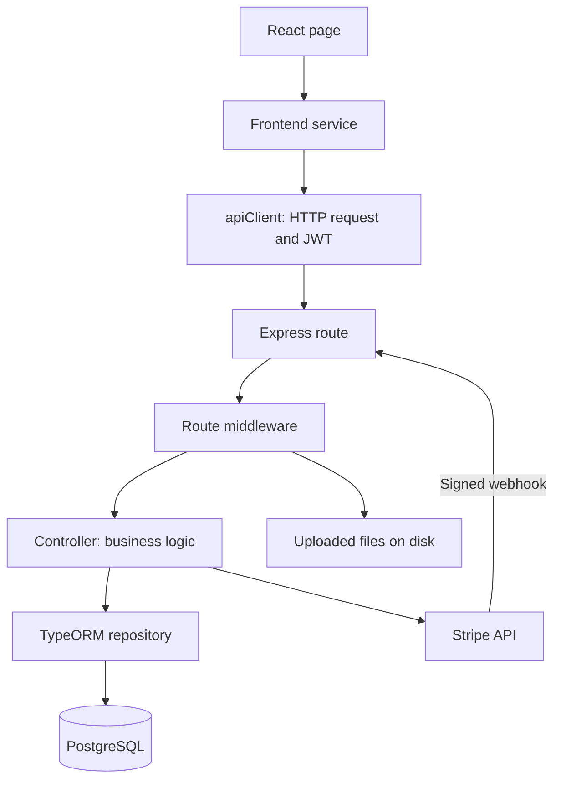
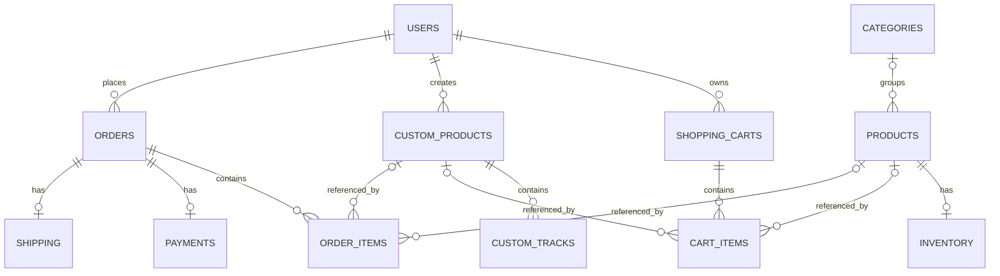

# Disc Market: architecture, services, and database

Baseline reviewed on October 16, 2026; inventory/checkout updated November 6, 2026.
See [stock and reservation behavior](STOCK.md). Hosting details below come
from the deployment records; this document does not certify the current live
server or a complete hosted purchase test.

## Repositories and responsibilities

Disc Market is one store split into two independent Git repositories:

| Repository | Responsibility |
|---|---|
| `disc-market-frontend` | React interface: catalog, authentication, cart, custom-disc creation, and payment form |
| `disc-market-backend` | Express API: business logic, database access, uploads, orders, and Stripe integration |

Each has its own dependencies, builds, commits, and pushes. The parent workspace
is not a third Git repository. Changes to the API contract may require changes
in both repositories.

Frontend files named `productService`, `cartService`, and similar are HTTP
helpers, not independent servers. Backend controllers are modules in one Express
application, not microservices.

A TypeORM **repository** is different from a Git repository: `cartRepo`, for
example, is a database-access object for shopping-cart records.

## Technologies and their roles

These are practical reasons the technologies fit the project, rather than a
record of every original design decision.

| Technology | Role and purpose |
|---|---|
| TypeScript | Main language in both repositories; adds compile-time type checking and compiles to JavaScript |
| React and React Router | Reusable browser components, state-driven updates, and page navigation |
| Tailwind CSS and CSS | Layout, styling, and responsive presentation |
| Vite | Frontend development server and optimized production build |
| Node.js and Express | Backend JavaScript runtime and HTTP routing/middleware |
| PostgreSQL | Relational storage for users, catalog, carts, orders, and related records |
| TypeORM | Maps entities to tables and provides queries and relationship loading |
| bcrypt and JWT | Password hashing and signed authentication tokens |
| Multer | Receives cover-image and audio uploads |
| Stripe | Payment interface, PaymentIntents, and signed payment notifications |
| Nginx, systemd, Ubuntu | Documented VPS web serving, API process management, and operating system |

## Request lifecycle



For example, the catalog calls `GET /api/products`. Express dispatches the
request to its controller, TypeORM reads PostgreSQL, and the API returns JSON.
React uses the response to display product cards. The browser does not connect
directly to PostgreSQL.

`src/shared/api/apiClient.ts` in the frontend centralizes requests, JSON handling,
errors, and the `Authorization: Bearer <token>` header. Upload requests use
FormData. Protected backend routes verify JWTs through authentication middleware;
resource ownership still needs separate authorization checks.

## Database model

Primary keys identify rows, such as `users.user_id`. Foreign keys link rows,
such as `orders.user_id` referencing a user.

| Table | Main responsibility | Relationships |
|---|---|---|
| `users` | Identity, unique email, password hash, role | One user has many carts, custom products, and orders |
| `categories` | Catalog grouping | One category has many products |
| `products` | Regular CD/vinyl catalog and current price | Optional category; one inventory record; referenced by cart/order items |
| `inventory` | Available and reserved quantities | Belongs to one product |
| `custom_products` | Owned personalized disc, cover path, packaging, and price | Belongs to a user; has many tracks |
| `custom_tracks` | Track name, file path, sequence, and duration | Belongs to one custom product |
| `shopping_carts` | User cart and lifecycle status | Belongs to a user; has many cart items |
| `cart_items` | Selected product, quantity, and unit price | Belongs to a cart; references regular or custom product |
| `orders` | Purchase owner, total, order/payment statuses | Belongs to a user; has many order items |
| `order_items` | Purchased quantities and unit prices | Belongs to an order; references regular or custom product |
| `payments` | Payment method, status, amount, Stripe identifier, receipt URL field | One-to-one relationship with an order |
| `shipping` | Shipping method, status, and tracking number | One-to-one relationship with an order |
| `checkout_reservations` | Persistent payment snapshot, amount, expiry, shipping address, and inventory reservation | Belongs to user/cart; links to the order after payment |



### Why separate item tables?

An order represents the whole purchase; each order item represents a line:

```text
orders: order_id=52, user_id=7, total_amount=65.00

order_items:
order_id=52, product_id=10, quantity=2, unit_price=20.00
order_id=52, product_id=18, quantity=1, unit_price=25.00
```

This is a many-to-many relationship between orders and products with extra
information: quantity and unit price. Carts use the same pattern. Keeping the
purchase unit price separately prevents later catalog price changes from
rewriting that stored purchase price.

An item is intended to reference exactly one of `product_id` or
`custom_product_id`. Both columns are nullable, and the entity definitions do not
declare a database check constraint enforcing that exclusive choice.

### Database features and deletion behavior

Entities declare generated IDs, foreign-key relationships, a unique user email,
defaults, nullable fields, and creation/update timestamps where applicable.
Money columns use `decimal(10,2)`. Controllers frequently convert database decimal
values with `Number()` for calculations or JSON responses; the database type
alone does not make JavaScript arithmetic exact.

TypeORM can load related records, such as an order with its items, products,
payment, and shipping, instead of returning only foreign-key IDs.

`onDelete: 'CASCADE'` deletes dependent database rows when a parent is removed:
for example, deleting a cart deletes its items. `onDelete: 'SET NULL'` preserves
an item when its referenced product is deleted but clears the product reference.
Order items retain quantity and unit price, but have no independent product-name
or description snapshot.

TypeORM's `cascade: true` on selected collections allows related entities to be
persisted through ORM operations. This is distinct from database `ON DELETE`
behavior. Neither mechanism automatically removes uploaded files from disk.

## Main workflows

### Registration and login

Registration hashes the password with bcrypt and stores the hash in `users`.
Login compares the submitted password against the hash and returns a JWT.
The frontend stores the token in localStorage and attaches it to API requests.
The backend checks it on protected routes. Authentication identifies the caller;
authorization determines which operations and records they may access.

### Adding to the cart

The controller finds or creates an active cart, loads the requested regular or
custom product, reads its database price, and saves a cart item. If the same item
already exists, it increases the quantity. Checkout calculates its total from
stored cart-item prices and quantities.

The schema permits multiple carts per user over time. The controller looks for
one with `status='active'`; the entity definitions do not enforce one active cart
per user through a partial unique index.

### Personalized discs and files

A custom disc creates a `custom_products` record. Track metadata goes into
`custom_tracks`, linked by `custom_product_id`. Covers and actual uploaded audio
are files on disk; the database stores paths such as
`/uploads/tracks/example.mp3`.

The controller also accepts metadata-only tracks and can assign a placeholder
path. A track row therefore does not prove that a real audio file was uploaded.
A complete backup needs both PostgreSQL data and uploaded files.

### Stripe checkout

1. The backend locks the cart and inventory, validates quantities and catalog
   prices, and saves a persistent checkout snapshot. Units move from available
   to reserved; editing the cart is blocked until payment/cancellation.
2. Stripe receives the snapshot amount in USD and an idempotency key. Repeated
   requests reuse the intent and the existing reservation.
3. Browser confirmation checks payment ownership and Stripe's `succeeded` status.
   Independently, signed webhooks can deliver the result to the backend.
4. Both success paths lock the same reservation and atomically create the order,
   items, payment, shipping, and cart conversion, consuming reserved inventory.
   A duplicate returns the existing order without a second stock deduction.
5. Cancellation/expiry releases units only after Stripe confirms cancellation.
   Processing or ambiguous network outcomes keep units reserved until reconciled.

The old simulated checkout endpoint now returns 410. See [STOCK.md](STOCK.md)
for expiry recovery, custom templates, deployment migration, and tests.

## Local execution and Hostinger

The documented deployment is an Ubuntu Hostinger VPS running Node.js,
PostgreSQL, Nginx, and systemd. The same application logic runs with different
environment settings and production builds.

| Development | Documented VPS deployment |
|---|---|
| Vite development server | Nginx serves the frontend build |
| Backend development runner | Node runs compiled backend JavaScript |
| Manually started API | systemd starts/restarts the API |
| Local database and uploads | Independent VPS database and persistent uploads |
| Local URLs and secrets | Production environment variables and HTTPS domain |

Nginx forwards `/api/` to the internal backend and serves `/uploads/` from
persistent storage. Frontend `VITE_*` settings are incorporated during its build;
changing them requires rebuilding.

GitHub pushes do not automatically update the VPS. The deployment records
describe SSH/SCP transfer and build/activation steps, without CI/CD or a server
Git checkout. Code, database contents, uploads, and secrets have separate
lifecycles. See [deployment details](DESPLIEGUE.md).

## Implemented model versus remaining work

- **Inventory and checkout:** stock validation, reservation, atomic order creation,
  and concurrent duplicate processing protection are implemented. Refunds and
  physical returns need a separate stock-restoration workflow.
- **Shipping:** tracking numbers are generated internally, with no demonstrated
  carrier integration. The shipping table has no delivery-address column; the
  address is now retained in the persistent checkout reservation.
- **Payment model:** one payment per order does not model multiple attempts or
  partial payments. The current success helper leaves `receipt_url` null.
- **Historical records:** deleting a user cascades to their orders. Review this
  policy before retaining real purchase histories.
- **Validation and authorization:** public registration always creates customers;
  admin endpoints verify the current database role. Product creation is protected,
  cart quantities/prices are validated, and simulated checkout is disabled.
  Remaining authorization/dependency review is still needed before real use.
- **Schema updates:** synchronization runs outside production and is disabled
  in production. TypeORM's configured migration list is empty; the documented
  Stripe and inventory changes use explicit SQL deployment scripts.
- **Operational verification:** deployment records describe Stripe test mode;
  complete hosted purchase verification, offsite backups, and restoration tests
  remain pending there.

## Source references

- [Entity definitions](../src/entities/)
- [Database configuration](../src/config/data-source.ts)
- [Routes and middleware selection](../src/routes/)
- [Cart controller](../src/controllers/cart.controller.ts)
- [Custom-product controller](../src/controllers/customProduct.controller.ts)
- [Stripe/payment controller](../src/controllers/payment.controller.ts)
- [Legacy order controller](../src/controllers/order.controller.ts)
- [Study questions](GUIA-ESTUDIO.md)
- [Deployment records](DESPLIEGUE.md)
