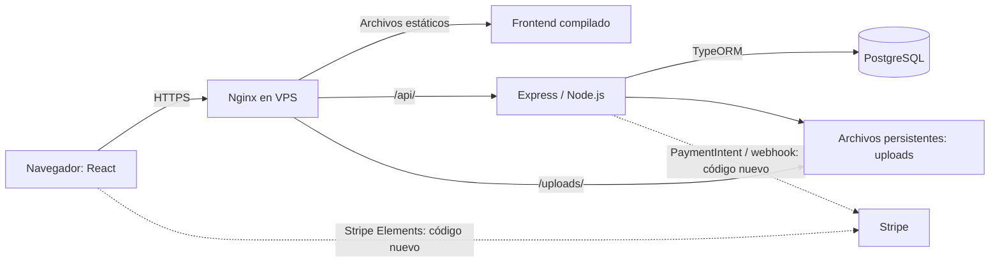

# Guía de estudio: preguntas y respuestas de Disc Market

Revisión: 16 de octubre de 2026, después de integrar `origin/main` en `yazmin`
en ambos repositorios. Las respuestas describen el código revisado, no solo el
diseño deseado. Stripe ya está en el código local actualizado; el VPS todavía
ejecuta la versión anterior a esos cambios. No afirmar que los pagos nuevos ya
están desplegados o probados de extremo a extremo.

## Presentación de un minuto

**1. ¿Qué construyeron?**

Una tienda de CDs y vinilos regulares y personalizados. React presenta el
catálogo, autenticación, personalización y carrito; una API Express administra
datos en PostgreSQL. Los archivos de portadas y audio se guardan en disco.
El código más reciente integra Stripe para el pago con tarjeta.

**2. ¿Cómo explicarías la arquitectura?**

Es una aplicación cliente-servidor con presentación, lógica y persistencia
separadas. El backend es una aplicación modular dentro de un único proceso;
no son microservicios. Los repositorios separados facilitan trabajar por área,
pero no implican que cada módulo sea un servicio independiente.



Las líneas de Stripe representan la integración nueva pendiente de despliegue.

## Tecnologías y responsabilidades

**3. ¿Para qué sirve cada tecnología?**

| Tecnología | Responsabilidad |
|---|---|
| React | Componentes y estado de la interfaz |
| TypeScript | Comprobar tipos al compilar; no valida por sí solo peticiones HTTP |
| Vite | Desarrollo y compilación del frontend |
| Tailwind | Estilos de la interfaz |
| React Router | Navegación de la SPA |
| Node.js | Ejecutar JavaScript del backend |
| Express | Rutas, middleware y respuestas HTTP |
| TypeORM | Mapear entidades y acceder a PostgreSQL |
| PostgreSQL | Persistencia relacional |
| Multer | Recibir archivos multipart |
| bcrypt | Hash de contraseñas |
| JWT | Token de autenticación firmado |
| Stripe | Procesamiento del pago con tarjeta en el código nuevo |
| Nginx | HTTPS, archivos estáticos y proxy inverso |
| systemd | Iniciar y reiniciar la API |

**4. ¿Qué es una SPA? ¿El servidor ejecuta React por cada página?**

La aplicación carga HTML y JavaScript; React cambia las vistas en el navegador.
Aquí no se configuró renderizado de React en servidor. Nginx devuelve
`index.html` si una ruta de la SPA no corresponde a un archivo, para que una
recarga de una página interna funcione.

**5. ¿Qué sucede al abrir el catálogo?**

DNS resuelve el dominio, el navegador conecta por HTTPS a Nginx y descarga el
frontend. Los servicios del frontend consultan `/api/products`; Nginx pasa la
petición a Express, el controlador consulta con TypeORM y PostgreSQL devuelve
los datos. Express responde JSON y React representa los productos.

**6. ¿Qué es una API REST y cómo se organizó?**

Expone recursos mediante HTTP y JSON. Las rutas de `src/routes/` conectan URLs
con controladores de `src/controllers/`; middleware procesa autenticación,
JSON o archivos; `src/entities/` describe las tablas y relaciones. No hay una
capa de servicios de negocio independiente en todos los módulos: varios
controladores consultan directamente repositorios de TypeORM.

**7. ¿Qué son GET, POST, PUT y DELETE?**

GET consulta; POST crea o inicia una operación; PUT actualiza según el contrato
implementado; DELETE elimina. Ejemplos: consultar productos, agregar al carrito,
actualizar una cantidad y retirar un artículo. Un 200 indica éxito, 201 creación,
400 petición inválida, 401 falta de autenticación, 403 acceso denegado, 404 recurso
inexistente y 500 error interno. La implementación concreta debe revisarse por ruta.

**8. ¿Cómo se conectan frontend y backend?**

`src/shared/api/apiClient.ts` del frontend centraliza `fetch`, errores y el token
Bearer. Los servicios de cada recurso usan ese cliente. Los mappers convierten
la estructura del backend a los tipos que espera la UI. En producción la base
de API es `/api`, con el mismo dominio; localmente son puertos distintos.

## Base de datos y archivos

**9. ¿Por qué PostgreSQL?**

El dominio contiene relaciones entre usuarios, productos, carritos, pedidos y
pagos. PostgreSQL permite claves foráneas, restricciones y transacciones.
Que el motor soporte transacciones no significa que todos nuestros flujos
ya estén agrupados dentro de una transacción de negocio.

**10. ¿Cuáles son las 12 tablas?**

| Tablas | Función |
|---|---|
| `users` | Usuarios y hash de contraseña |
| `categories`, `products`, `inventory` | Categorías, productos regulares y existencias |
| `custom_products`, `custom_tracks` | Productos personalizados y pistas |
| `shopping_carts`, `cart_items` | Carritos y sus artículos |
| `orders`, `order_items` | Pedidos y detalle histórico |
| `payments`, `shipping` | Pago y envío asociados al pedido |

**11. ¿Cómo se relacionan?**

Una categoría agrupa productos; un producto tiene inventario. Un usuario puede
tener carritos, personalizados y pedidos. Carritos y pedidos tienen varios
artículos; los artículos pueden referirse a producto regular o personalizado.
Un personalizado tiene varias pistas. Las entidades modelan un pago y un envío
por pedido. Las claves foráneas conectan esos registros.

**12. ¿Por qué guardar precio en `cart_items` y `order_items`?**

Representa el precio unitario aplicado al artículo. El detalle del pedido puede
conservar el importe aunque cambie el catálogo. Aun así hay que definir cuándo
revalidar precios de carritos antiguos; guardar un precio no resuelve por sí
solo cantidades inválidas, stock o cambios concurrentes.

**13. ¿Qué hace TypeORM?**

Las entidades usan decoradores para mapear clases a tablas. El DataSource abre
la conexión y los repositorios permiten buscar y guardar registros. TypeORM
no sustituye controles de permisos ni validación de entradas.

**14. ¿Cómo se crearon las tablas y datos iniciales?**

El seed crea categorías, ocho productos y su inventario. En la instalación
inicial del VPS, sobre una base vacía, se ejecutó con sincronización habilitada.
En funcionamiento normal `NODE_ENV=production` desactiva `synchronize`.
Actualmente no existe un conjunto de migraciones que cubra cambios futuros.

**15. ¿Dónde se guardan audios e imágenes?**

Multer escribe archivos en el disco y la base guarda rutas y metadatos. En el
VPS están en `/var/lib/disc-market/uploads`; Nginx los sirve bajo `/uploads/`.
Los límites del middleware son 10 MB por portada y 50 MB por pista; Nginx
limita el cuerpo completo de la petición a 100 MB. Varias pistas pueden superar
ese total aunque cada una respete su límite individual.

**16. ¿Un producto personalizado siempre tiene audio real?**

No necesariamente: el código acepta metadatos y puede usar una ruta placeholder.
También existe carga real de pistas. Debemos distinguir registros de prueba de
archivos realmente subidos; un nombre de pista no garantiza que exista audio.
El precio personalizado recibido del cliente necesita validación del servidor.

## Sesión, carrito y compra

**17. ¿Cómo funciona el registro e inicio de sesión?**

El backend genera un hash bcrypt al registrar, compara el hash al iniciar sesión
y emite un JWT firmado. El frontend guarda token y datos de usuario en
`localStorage`; al cargar intenta validar la sesión con el backend. Cerrar sesión
retira esos datos locales. JWT firmado no significa contenido cifrado.

**18. ¿Autenticación y autorización son iguales?**

No. Autenticación identifica a la persona; autorización determina si puede
consultar o modificar ese recurso. Tener un JWT no basta: cada operación debe
comprobar dueño y rol. Hay rutas con autenticación opcional o sin middleware y
fallbacks al primer usuario que deben eliminarse antes de producción real.

**19. ¿Por qué es delicado guardar el token en localStorage?**

Permite persistir la sesión al recargar, pero JavaScript de la página puede
leerlo. Una vulnerabilidad XSS podría robarlo. Hay que prevenir XSS y evaluar
una estrategia de sesión adecuada; HTTPS por sí solo no corrige ese riesgo.

**20. ¿Cómo funciona el carrito sin sesión y con sesión?**

`CartContext` mantiene estado React y copia local en `localStorage`. Al iniciar
sesión consulta el carrito remoto y envía artículos locales pendientes. Cuando
hay sesión, las modificaciones intentan persistirse en la API. Es una UI
optimista: puede mostrar un cambio antes de que el servidor lo confirme; algunos
errores solo se registran y requieren mejorar la reconciliación.

**21. ¿Qué sucede al agregar un producto regular?**

El frontend envía identificador y cantidad. El backend busca el producto,
obtiene su precio y crea o incrementa el artículo del carrito activo. No debemos
afirmar que ya reserva stock: la existencia de `inventory` no prueba una reserva
atómica integrada en el checkout actual.

**22. ¿Todos los métodos de pago cobran dinero?**

No. La pantalla nueva envía tarjeta/Stripe por el flujo de Stripe, mientras
otros métodos usan el checkout alternativo. Ese controlador anterior marca
el pedido pagado sin consultar una pasarela: es una simulación, no una
confirmación bancaria. No debe habilitarse así para ventas reales.

## Stripe: explicar lo que se añadió

**23. ¿Cuál es el flujo nuevo de tarjeta?**

1. El frontend solicita `POST /api/payments/create-intent`.
2. El backend suma `unit_price × quantity` del carrito guardado.
3. Crea un PaymentIntent en Stripe y devuelve su `clientSecret`.
4. Stripe Elements muestra el formulario; el navegador llama `confirmPayment`.
5. Si el estado es `succeeded`, el frontend pide `/api/payments/confirm`.
6. El backend consulta el PaymentIntent en Stripe y genera pedido, artículos,
   registro de pago y envío; marca el carrito como convertido.
7. El webhook `payment_intent.succeeded` también intenta consolidar la compra.

Es el flujo leído en el código nuevo, todavía pendiente de desplegar y probar.

**24. ¿Qué datos de tarjeta almacenamos?**

En este diseño el formulario de Stripe maneja la captura de tarjeta. Nuestro
backend recibe identificadores de pago y guarda el identificador de transacción,
importe y estado; no hay campos de PAN/CVC en la entidad Payment. Usar Stripe
no implica por sí solo que toda la aplicación sea segura o cumpla todos los
requisitos de una operación comercial.

**25. ¿Para qué sirve cada variable de Stripe?**

| Variable | Ubicación | Tratamiento |
|---|---|---|
| `VITE_STRIPE_PUBLISHABLE_KEY` | Frontend, incorporada al build | Clave publicable; visible en navegador |
| `STRIPE_SECRET_KEY` | Backend `.env` | Secreto; nunca en Git o frontend |
| `STRIPE_WEBHOOK_SECRET` | Backend `.env` | Secreto de firma del endpoint de webhook |

La clave publicable no sustituye la secreta. No poner secretos en variables
`VITE_*`, porque sus valores pueden quedar expuestos en el JavaScript público.
No se copian claves reales a esta guía. Los secretos compartidos en capturas
deben rotarse antes de configurarlos.

**26. ¿Test y producción son lo mismo?**

No. La configuración recibida era de prueba. El modo test sirve para simular
pagos; no demuestra cobros reales. Frontend y backend deben usar claves de la
misma cuenta y entorno. No cambiamos a claves reales durante esta revisión.

**27. ¿Por qué un webhook si el navegador ya confirma?**

El navegador puede cerrarse o perder conexión después del pago. Stripe puede
notificar al servidor directamente. La firma debe verificarse con el cuerpo
original, que `app.ts` conserva como `rawBody`. El código actual acepta eventos
sin verificar cuando falta firma o secreto: debe rechazarlos en producción.

**28. ¿El secreto de Stripe CLI sirve siempre para el VPS?**

No hay que asumirlo. El secreto debe corresponder al endpoint que recibe los
eventos. Al crear el destino HTTPS del VPS en Stripe hay que configurar su
secreto de firma correspondiente. No basta con copiar un secreto usado al
reenviar eventos a localhost.

**29. ¿Qué significa idempotencia y ya la tenemos resuelta?**

Repetir la misma operación no debería duplicar el pedido. El código busca un
pago por `transaction_id` antes de crearlo, pero no vemos una restricción única
en esa columna ni una transacción completa que proteja dos solicitudes
simultáneas. Por eso existe una protección parcial, no una garantía completa.
También debe manejarse el reintento si el procesamiento del webhook falla:
actualmente puede responder 200 aunque falle la creación del pedido.

**30. ¿El importe del navegador es confiable? ¿Qué moneda se usa?**

El PaymentIntent suma el carrito de la base, lo cual evita tomar directamente
un total del navegador. Pero deben validarse cantidades, precios personalizados,
propiedad del carrito y cambios entre creación y confirmación. El código nuevo
fija `currency: 'usd'` y multiplica por 100 para centavos; no convierte MXN a USD.
La moneda del catálogo y la del cobro deben acordarse antes de probar ventas.

**31. ¿Qué falta para asegurar la compra?**

Autenticar las rutas de pago; obtener identidad del JWT y verificar pertenencia
del PaymentIntent; quitar fallback al primer usuario; guardar una instantánea
consistente de los artículos; validar inventario y precio; usar transacciones y
unicidad para evitar duplicados; exigir firma del webhook y manejar sus reintentos.
El número de tracking generado es interno de demostración, no de una paquetería.

**32. ¿Los cambios de Stripe necesitan modificar la base del VPS?**

Sí: Payment añadió `transaction_id` y `receipt_url`. Como producción no
sincroniza automáticamente, hay que preparar y aplicar una migración antes
de desplegar el nuevo backend. Compilar o reiniciar no crea esas columnas.

## Hosting y operación

**33. ¿Por qué VPS y por qué KVM 1?**

El VPS nos deja ejecutar API, PostgreSQL y archivos en un servidor controlado
por el equipo. Elegimos KVM 1 como punto de partida para demo y tráfico ligero.
Su suficiencia se monitorea; no es una promesa de capacidad para cualquier carga.
Podríamos usar servicios administrados separados en otra arquitectura.

**34. ¿Qué hacen Ubuntu, Nginx y systemd?**

Ubuntu es el sistema operativo del servidor. Nginx recibe HTTPS y sirve o
redirige solicitudes. systemd ejecuta la API con el usuario `discmarket`, la
inicia al arrancar y la reinicia ante fallo. Cerrar VS Code no apaga esos servicios.

**35. ¿Qué diferencia hay entre dominio, DNS, IP y HTTPS?**

El dominio es el nombre; DNS indica a qué servidor llegar; la IP identifica el
destino de red; HTTPS cifra y autentica la conexión mediante un certificado.
No son equivalentes a autenticación de usuario o permisos de una API.

**36. ¿Por qué quitamos AAAA?**

El A apunta `vinylhrz.tech` a la IPv4 del VPS. El CNAME hace que `www` use el
mismo nombre. El AAAA anterior enviaba clientes IPv6 a otro destino. Lo quitamos
porque no habíamos configurado ese destino como servidor de esta aplicación.

**37. ¿Se instala pgAdmin en el VPS para que funcione la tienda?**

No. PostgreSQL es el servidor de base de datos; pgAdmin es un cliente visual.
Podemos usar pgAdmin en Windows para la base local o, con un túnel SSH, para la
del VPS. Las dos bases son independientes y sus datos no se sincronizan solos.

**38. ¿Qué se conserva al publicar cambios?**

La base de datos, el `.env` del VPS y uploads deben mantenerse aparte del código.
No se reemplazan por la base ni los secretos locales. Un cambio de esquema se
aplica con migración; no se borra la base para actualizar la aplicación.

**39. ¿Cómo detectamos un fallo?**

Revisar red del navegador, health de API, logs y estado de los servicios.
`systemctl status disc-market nginx postgresql`,
`journalctl -u disc-market -n 50 --no-pager` y `nginx -t` ayudan.
Un health OK prueba respuesta del endpoint; no prueba pagos ni todo el negocio.

**40. ¿Qué respaldamos y qué falta?**

Hay copia diaria local de base y uploads en `/var/backups/disc-market`.
Guardar solo código en Git no respalda usuarios, pedidos ni archivos.
Todavía faltan copias externas, retención y prueba de restauración. Si se pierde
el VPS completo, sus copias locales también podrían perderse.

## Git y cómo cambiar cosas

**41. Mi compañero cambió main: ¿pull antes o después?**

Primero revisar `git status` y guardar nuestro trabajo en un commit. Después
`git fetch origin` descarga referencias; estando en `yazmin`,
`git merge origin/main` integra lo nuevo. Resolver conflictos si aparecen,
probar y hacer push de `yazmin`. No hace falta cambiar a main para este flujo.
Frontend y backend requieren estos pasos por separado.

```powershell
git status
git branch --show-current
# Revisar y agregar únicamente archivos propios; nunca .env.
git add docs/GUIA-ESTUDIO.md
git commit -m "docs: add study guide"
git fetch origin
git merge origin/main
npm.cmd ci
npm.cmd run build
git push -u origin yazmin
```

El `git add` es un ejemplo; el archivo existe en backend. En frontend se deben
agregar los archivos de ese repositorio. No crear un commit si no hay cambios.
Si el archivo no se ha creado, no copiar el comando literalmente.

**42. ¿Qué diferencia hay entre fetch, pull, merge y push?**

Fetch descarga referencias sin integrar cambios en nuestra rama. Merge integra
una referencia en la rama actual. Pull hace fetch y luego integra según la
configuración; un pull normal en `yazmin` suele traer `origin/yazmin`, no main.
Push publica commits locales. `git pull origin main` integra main en la rama
actual, pero aquí preferimos separar fetch y merge para ver qué se está haciendo.

**43. ¿Ya estamos en mi rama y ya está en el hosting?**

Ambos repositorios locales usan `yazmin`; main se integró con avance rápido sin
conflictos. La documentación se publica en esa rama cuando se hace push.
El VPS es una copia sin checkout Git: no tiene una rama activa y no recibe
automáticamente los cambios de GitHub. Merge, push y despliegue son pasos distintos.

**44. ¿Qué es un Pull Request?**

Una propuesta para revisar e integrar una rama a otra, normalmente `yazmin`
hacia `main`. No es lo mismo que pull ni equivale a desplegar. El equipo debe
acordar qué rama representa una versión aprobada para el servidor.

**45. ¿Cómo cambio un color, una ruta o un campo de base?**

| Cambio | Dónde trabajar | Qué publicar |
|---|---|---|
| Color o diseño | Componentes y estilos del frontend | Nuevo build frontend |
| Página nueva | Feature y React Router | Nuevo build frontend |
| Endpoint o validación | Ruta/controlador/middleware backend | Build y reinicio API |
| Campo persistente | Entidad, migración y contratos relacionados | Migración y builds afectados |
| Nueva clave Stripe | Entorno correcto, fuera de Git | Rebuild frontend si es VITE; reinicio backend para secretos |
| Dominio | DNS, Nginx, certificado y variables | Configuración y build frontend |

**46. ¿Cómo subimos una versión al VPS?**

Probar localmente, guardar y revisar commits, respaldar datos, transferir código,
instalar dependencias, compilar y aplicar migraciones si existen. Después
reiniciar API o publicar frontend y comprobar logs, health y flujo funcional.
No ejecutar el script de instalación inicial como si fuera un deploy rutinario:
contiene la configuración inicial por IP. Ver [DESPLIEGUE.md](DESPLIEGUE.md).

**47. ¿Qué pasa si una actualización falla?**

Volver al código/build anterior y revisar logs. Una migración puede requerir
reversión o restauración planificada; volver al código no revierte los datos.
Hoy no hay rollback automatizado ni CI/CD configurado.

## Preguntas difíciles y práctica oral

**48. ¿Qué limitaciones reconocemos con honestidad?**

Es una demo con autorización incompleta, checkout alternativo simulado y pagos
nuevos pendientes de validación. Hay riesgo de duplicados concurrentes,
stock no reservado de forma atómica y precios personalizados que necesitan
validación. HTTPS funciona, pero no corrige estas reglas del negocio.

**49. ¿Qué pasaría si crece mucho la tienda?**

Primero medir CPU, memoria, disco, latencia y consultas. Según el cuello de
botella, optimizar índices y consultas, aumentar recursos, mover uploads a
almacenamiento de objetos o separar la base. No afirmar que necesitamos
microservicios sin mediciones.

**50. ¿Cómo demostraríamos el sistema al profesor?**

Abrir catálogo, inspeccionar una petición a `/api/products`, explicar el JSON y
las tablas; mostrar sesión y carrito; crear un personalizado distinguiendo
metadatos de archivos reales; explicar Stripe con sus estados sin prometer un
cobro no probado; mostrar dominio HTTPS, servicio y logs. Cerrar explicando
GitHub versus despliegue y pendientes de producción. No mostrar `.env`,
contraseñas, tokens ni claves secretas en pantalla.

### Repaso sin leer

1. Dibujar navegador → Nginx → Express → PostgreSQL y ubicar uploads.
2. Explicar registro, carrito y checkout en dos minutos.
3. Diferenciar JWT, HTTPS y permisos.
4. Explicar qué problema resuelve el webhook y por qué necesita firma.
5. Explicar un cambio visual y uno de base de datos hasta publicarlos.
6. Decir qué está desplegado, qué se integró en Git y qué falta probar.

## Archivos para comprobar las respuestas

- Backend: `src/app.ts`, `src/config/data-source.ts`, `src/routes/`,
  `src/controllers/`, `src/entities/`, `src/middlewares/`, `src/seed/seed.ts`.
- Pagos: `src/controllers/payment.controller.ts`, `src/routes/payment.routes.ts`
  y `src/entities/Payment.ts`.
- Frontend: `src/context/`, `src/shared/api/`, `src/features/cart/CartPage.tsx`,
  `src/features/cart/components/StripeCheckoutModal.tsx`, `src/shared/lib/stripe.ts`.
- Operación: [DESPLIEGUE.md](DESPLIEGUE.md) y [LOCAL-SETUP.md](LOCAL-SETUP.md).
