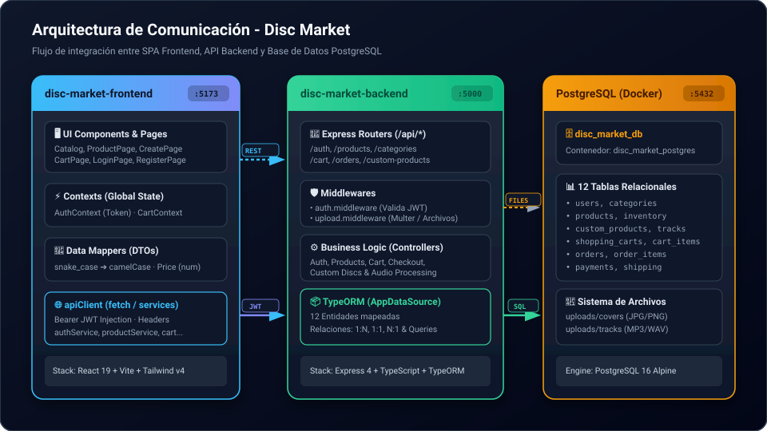
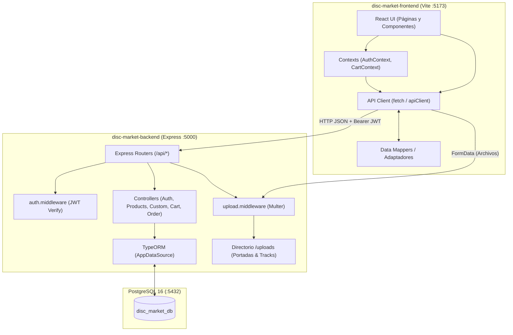

# 📋 Guía Técnica de Integración: Backend, Frontend y Base de Datos (Disc Market)

> **Documento de referencia técnica y plan de ejecución** para la conexión entre `disc-market-frontend`, `disc-market-backend` y PostgreSQL.

---

## 1. 📌 Resumen Ejecutivo y Diagnóstico

Actualmente, ambos repositorios se encuentran en la rama `feat/back-front-connection`. Aunque cada proyecto funciona de forma individual en su entorno de desarrollo:

* **Frontend (`disc-market-frontend`)**: Es una SPA en React 19 + TypeScript + Vite que opera como una maqueta desacoplada. Los productos provienen de un archivo estático en memoria ([products.ts](../../disc-market-frontend/src/data/products.ts)), la autenticación y el carrito se simulan en `localStorage`, y no realiza llamadas de red hacia el backend.
* **Backend (`disc-market-backend`)**: Es una API REST en Express 4 + TypeORM + TypeScript conectada a PostgreSQL 16. Cuenta con las entidades y controladores para catálogo, carrito, personalización y órdenes, pero carece de middleware para verificar JWT en rutas protegidas, no cuenta con endpoint para categorías ni para validar la sesión actual (`/auth/me`), y sus entidades usan nomenclatura `snake_case` que no coincide directamente con los tipos de TypeScript del frontend.
* **Base de datos (PostgreSQL)**: Contiene 12 tablas generadas por TypeORM en el contenedor `disc_market_postgres`, pero con un conjunto de datos inicial limitado a 3 productos de prueba.

---

## 2. 🏗️ Arquitectura de Comunicación



```text
┌─────────────────────────────────┐        HTTP / JSON         ┌─────────────────────────────────┐        TCP / SQL         ┌─────────────────────────────────┐
│     disc-market-frontend        │   (Bearer JWT / Auth)      │      disc-market-backend        │   (Port 5432)            │       PostgreSQL 16             │
│        (Port 5173)              ├───────────────────────────►│          (Port 5000)            ├─────────────────────────►│     (disc_market_postgres)      │
├─────────────────────────────────┤                            ├─────────────────────────────────┤                          ├─────────────────────────────────┤
│ • UI Pages & Components         │        FormData            │ • Express API Routers (/api/*)  │                          │ • 12 Tablas relacionales        │
│ • Contexts (Auth / Cart)        │   (Uploads / Archivos)     │ • auth.middleware (Valida JWT)  │                          │   (users, products, orders...)  │
│ • Data Mappers (DTOs)           ├───────────────────────────►│ • upload.middleware (Multer)    │                          │                                 │
│ • apiClient (fetch / services)  │                            │ • TypeORM (Data Source)         │                          │ • uploads/ (Portadas y Audios)  │
└─────────────────────────────────┘                            └─────────────────────────────────┘                          └─────────────────────────────────┘
```

<details>
<summary><b>Ver definición Mermaid original</b></summary>



</details>

---

## 3. 🔍 Matriz de Discrepancias y Contratos de Datos

| Concepto | Backend (`disc-market-backend`) | Frontend (`disc-market-frontend`) | Acción requerida |
| :--- | :--- | :--- | :--- |
| **Nomenclatura de claves** | `snake_case` (`product_id`, `custom_product_id`, etc.) | `camelCase` (`productId`, `customId`, etc.) | Crear funciones de mapeo en frontend (ej. `toProductDto`). |
| **Formato de Producto** | Strings mixtos: `'Vinyl'`, `'CD'` | Tipado estricto: `"VINYL" \| "CD"` | Normalizar valores a mayúsculas al recibir del backend. |
| **Tipo de Precio (`price`)** | PostgreSQL `decimal(10,2)` retorna `string` (ej. `"699.00"`) | `number` (aritmética flotante en JS) | Parsear con `Number(p.price)` o `parseFloat()` en el mapeador. |
| **Categorías** | Relación `category: { category_id, category_name }` | String plano: `category: "Pop"` | Extraer `product.category?.category_name` y crear endpoint `GET /api/categories`. |
| **Imágenes / Carátulas** | `image_url` (URL web o `/uploads/covers/...`) | `cover: CoverTheme` (gradientes y motivos CSS en [AlbumCover.tsx](../../disc-market-frontend/src/shared/ui/AlbumCover.tsx)) | Adaptar `AlbumCover` para admitir `image_url` real con fallback visual al gradiente. |
| **Estado de Stock** | `inventory.quantity_available: number` | Enum: `"AVAILABLE" \| "LOW_STOCK" \| "OUT_OF_STOCK"` | Derivar el estado según el umbral disponible (`> 5`, `<= 5`, `= 0`). |
| **Pistas de regulares** | No existen en la entidad `Product` (solo catálogo base) | Lista `tracks: ProductTrack[]` en mock | Aceptar `tracks?: ProductTrack[]` como opcional o persistir tracks en entidad si se requiere. |
| **Subida de Personalizados** | Requiere archivos binarios obligatorios en Multer | Solo almacena cadenas de texto en el borrador (`draft.coverName`, pistas como texto) | Permitir subida opcional de archivos o enviar FormData con archivo real. |

---

## 4. 🔗 Matriz de Endpoints vs Vistas

| Módulo | Endpoint Backend | Método | Vista Frontend Correspondiente | Payload / Parámetros |
| :--- | :--- | :---: | :--- | :--- |
| **Auth** | `/api/auth/register` | `POST` | `RegisterPage.tsx` | `{ name, email, password }` |
| **Auth** | `/api/auth/login` | `POST` | `LoginPage.tsx` | `{ email, password }` |
| **Auth** | `/api/auth/me` *(Nuevo)* | `GET` | `AuthContext.tsx` | Header `Authorization: Bearer <token>` |
| **Catálogo** | `/api/products` | `GET` | `CatalogPage.tsx`, `HomePage.tsx` | `?format=&search=&category_id=&artist=` |
| **Catálogo** | `/api/products/:id` | `GET` | `ProductPage.tsx` | Param `:id` |
| **Categorías** | `/api/categories` *(Nuevo)* | `GET` | `CatalogPage.tsx` (Filtros) | Lista de categorías activas |
| **Personalizado** | `/api/custom-products` | `POST` | `CreatePage.tsx` | `FormData`: `user_id, format, title, cover, message, packaging_option, price` |
| **Pistas Custom** | `/api/custom-products/:id/tracks` | `POST` | `CreatePage.tsx` | `FormData`: `tracks[]`, `tracks_meta` (JSON) |
| **Carrito** | `/api/cart/user/:user_id` | `GET` | `CartContext.tsx`, `CartPage.tsx` | Param `:user_id` |
| **Carrito** | `/api/cart/items` | `POST` | `CartContext.tsx` | `{ user_id, product_id, custom_product_id, quantity }` |
| **Carrito** | `/api/cart/items/:item_id` | `DELETE`| `CartContext.tsx` | Param `:item_id` |
| **Checkout** | `/api/orders/checkout` | `POST` | `CartPage.tsx` | `{ user_id, payment_method, shipping_method, shipping_address }` |
| **Órdenes** | `/api/orders/:id` | `GET` | `CartPage.tsx` (`OrderOkPage`) | Param `:id` |

---

## 5. 📝 Plan de Trabajo y Checklist de Tareas

### Fase 1: Infraestructura y Cliente HTTP Base
- [x] **Frontend**: Crear archivo `.env` en la raíz de `disc-market-frontend` con `VITE_API_URL=http://localhost:5000/api` y `VITE_UPLOADS_URL=http://localhost:5000`.
- [x] **Frontend**: Crear módulo de cliente HTTP tipado (`src/shared/api/apiClient.ts`) con gestión de tokens y manejo centralizado de respuestas y errores.
- [x] **Frontend**: Implementar adaptadores/mapeadores (`src/shared/api/mappers.ts`) para transformar respuestas de la API a los tipos de la interfaz.

### Fase 2: Autenticación y Gestión de Sesión
- [ ] **Backend**: Crear middleware `auth.middleware.ts` para verificar y decodificar el token JWT en las cabeceras `Authorization`.
- [ ] **Backend**: Agregar endpoint `GET /api/auth/me` para retornar la información del usuario autenticado a partir del token.
- [ ] **Frontend**: Crear `authService.ts` con funciones `login`, `register` y `getMe`.
- [ ] **Frontend**: Actualizar `AuthContext.tsx` para almacenar `user_id`, `name`, `email`, `role` y `token`, validando la sesión en la carga inicial.
- [ ] **Frontend**: Modificar `LoginPage.tsx` y `RegisterPage.tsx` para invocar al backend y mostrar mensajes de error dinámicos.

### Fase 3: Catálogo, Búsqueda y Detalle de Productos
- [ ] **Backend**: Crear `category.controller.ts` y ruta `GET /api/categories` para exponer las categorías disponibles.
- [ ] **Backend**: Ajustar `getProducts` en `product.controller.ts` para soportar filtro por nombre de categoría y asegurar que `price` retorne como número.
- [ ] **Backend**: Ampliar el script `seed.ts` con los 10 productos del catálogo con carátulas e inventarios correspondientes.
- [ ] **Frontend**: Crear `productService.ts` con `getProducts`, `getProductById` y `getCategories`.
- [ ] **Frontend**: Actualizar `AlbumCover.tsx` para renderizar etiquetas `` si se provee una URL de imagen, manteniendo el gradiente como fallback.
- [ ] **Frontend**: Conectar `HomePage.tsx` y `CatalogPage.tsx` para consumir `getProducts` con estados de carga y errores.
- [ ] **Frontend**: Conectar `ProductPage.tsx` para consultar el producto por ID desde el backend.

### Fase 4: Personalización y Subida de Archivos
- [ ] **Backend**: Permitir que `addTracksToCustomProduct` en `customProduct.controller.ts` acepte metadatos de pistas incluso si no se adjuntan archivos binarios.
- [ ] **Frontend**: Crear `customProductService.ts` para enviar datos de carátula y pistas.
- [ ] **Frontend**: Modificar `CreatePage.tsx` para retener el archivo binario de la imagen y enviarlo mediante `FormData` al backend al finalizar el asistente.

### Fase 5: Carrito de Compras Persistente
- [ ] **Frontend**: Crear `cartService.ts` para conectar con `/api/cart/user/:user_id`, `/api/cart/items` y `/api/cart/items/:item_id`.
- [ ] **Frontend**: Actualizar `CartContext.tsx` para sincronizar las altas, bajas y cambios de cantidad con la base de datos cuando exista sesión activa.

### Fase 6: Checkout y Órdenes de Compra
- [ ] **Frontend**: Crear `orderService.ts` con la función `checkout(data)`.
- [ ] **Frontend**: Conectar el botón "Ir a pagar" en `CartPage.tsx` para disparar la orden en `/api/orders/checkout`.
- [ ] **Frontend**: Enviar la respuesta (`order_id`, `tracking_number`, `total_amount`) como estado de navegación hacia `OrderOkPage` para mostrar el resumen real de la compra.

### Fase 7: Validación y Pruebas
- [ ] Validar flujo completo de registro y login de usuario.
- [ ] Validar filtrado dinámico en catálogo desde la base de datos PostgreSQL.
- [ ] Validar creación de disco personalizado con subida de archivo y comprobación en la carpeta local `uploads/`.
- [ ] Validar flujo de carrito, checkout y generación de registros en las tablas `orders`, `order_items`, `payments` y `shipping`.
