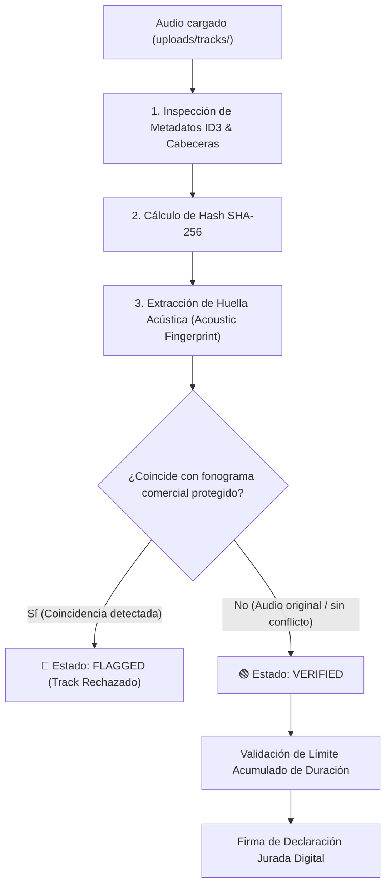

# 🎵 Plan de Implementación: Subida de Audios y Validación de Copyright (Módulo 3)
## Proyecto: Disc Market (Backend & Frontend)
> **Fecha:** Noviembre 2026  
> **Rama de trabajo:** `fix/general-bugs`  
> **Estado:** 📋 Planificación detallada y especificación técnica  
> **Referencia:** [`PENDING_FEATURES.md`](../../disc-market-frontend/PENDING_FEATURES.md) (Módulo 3)

---

## 1. 📌 Visión General de la Funcionalidad

El **Módulo 3** transforma el creador de discos personalizados ([`CreatePage.tsx`](../../disc-market-frontend/src/features/custom/CreatePage.tsx)) en un pipeline completo de manufactura digital:
1. **Subida real de archivos binarios de audio** con validación física de capacidades (CD: 80 min / Vinilo: 44 min).
2. **Sistema de tres capas de Copyright Compliance** para impedir la fabricación de fonogramas comerciales protegidos por derechos de autor (Sony, Universal, Warner, etc.).
3. **Firma digital legal** de declaración jurada vinculada criptográficamente (SHA-256) a los archivos subidos.

---

## 2. 🛡️ ¿Cómo validará `copyright.service.ts` los fonogramas protegidos?

Para garantizar el cumplimiento de la **Ley Federal del Derecho de Autor** y evitar la piratería fonográfica, `copyright.service.ts` implementa una arquitectura híbrida de **3 capas**:



### A. Capa de Inspección de Metadatos y Tags ID3 / RIFF
* Se analizan los bloques de metadatos incrustados en el contenedor de audio (título de pista, artista, ISRC, código UPC, álbum y sello discográfico).
* Si el archivo contiene metadatos comerciales de discográficas registradas (Universal Music Group, Sony Music, Warner Music Group, EMI Records, etc.), se activa una alerta preliminar.

### B. Capa de Huella Acústica (Acoustic Fingerprinting & Audio Hashing)
* **Principio físico:** Modificar el nombre del archivo o borrar los tags ID3 **no** altera la señal acústica de audio. La huella acústica analiza las frecuencias de onda en el espectro audible (*Chromaprint / AcoustID*).
* **Motor en `copyright.service.ts`:**
  1. **Generación de Fingerprint:** Se procesa una muestra de la forma de onda del audio binario generando un vector de huella acústica perceptual.
  2. **Comparador de Catálogo de Protección:** Se confronta contra una base de firmas de fonogramas protegidos de alta rotación comercial (ej. *Thriller*, *Billie Jean*, *Bohemian Rhapsody*, *Back in Black*, etc.).
  3. **Conector Extensible para APIs Externas:** El servicio implementa una interfaz adaptable para conectar en producción con servicios como **AcoustID API** o **AudD Music Recognition API**, manteniendo un analizador local de firmas para desarrollo, pruebas offline y entornos aislados.

### C. Generación del Hash SHA-256 de Cadena de Custodia
* Cada archivo de audio genera un hash criptográfico `SHA-256` inmutable.
* Este hash se almacena en la base de datos junto con el `user_id`, la dirección IP de origen y la marca de tiempo exacta, vinculando la declaración jurada legal del cliente con los archivos exactos subidos.

---

## 3. 💾 ¿Cómo se van a guardar y gestionar los audios?

### A. Ciclo de Vida del Almacenamiento en Disco
1. **Directorio dedicado:** Los audios se almacenan localmente en `uploads/tracks/` (asegurado y creado automáticamente por el servidor).
2. **Nomenclatura segura e insensible a colisiones:**
   ```text
   track-${timestamp}-${randomSuffix}${ext}
   Ejemplo: track-1730932145000-847291034.mp3
   ```
3. **Límites físicos en Multer:**
   * **CD:** Hasta 50 MB por archivo (máx. 20 pistas, total 80 minutos).
   * **Vinilo:** Hasta 75 MB por archivo (máx. 12 pistas, total 44 minutos).

### B. Pipeline de Seguridad e Integridad en la Subida
1. **Multer Disk Streaming:** El archivo se descarga en el directorio temporal de tracks.
2. **Inspección de Magic Bytes:** El middleware `validateAudioMagicBytes` (implementado en Fase 1) valida la firma binaria real del archivo (MP3, WAV, OGG, FLAC, M4A) para rechazar ejecutables camuflados.
3. **Escaneo de Copyright & Extracción de Duración:** `copyright.service.ts` calcula la duración real en segundos, tamaño en bytes y estatus de derechos.
4. **Mecanismo de Rollback Automático:** Si el track es rechazado (`FLAGGED`), si la duración excede el límite del medio o si la inserción en PostgreSQL falla, `safelyDeleteFile` / `safelyDeleteFiles` elimina inmediatamente los audios del disco para evitar archivos basura.

### C. Streaming y Reproducción en la Aplicación
* La API sirve los archivos bajo la ruta pública `/uploads/tracks/:filename`.
* Soporta cabeceras HTTP `Range` (`206 Partial Content`), lo que permite que el reproductor HTML5 en el frontend cargue instantáneamente el audio, adelante o pause la pista sin tener que descargar el archivo completo previamente.

---

## 4. 🗃️ Modelo de Datos Extendido (PostgreSQL)

```sql
-- Extensión de custom_tracks para auditoría de audio y copyright
ALTER TABLE custom_tracks ADD COLUMN copyright_status VARCHAR(20) DEFAULT 'PENDING'; -- 'VERIFIED', 'FLAGGED', 'PENDING'
ALTER TABLE custom_tracks ADD COLUMN copyright_match_title VARCHAR(200);
ALTER TABLE custom_tracks ADD COLUMN copyright_match_artist VARCHAR(200);
ALTER TABLE custom_tracks ADD COLUMN file_size_bytes BIGINT DEFAULT 0;
ALTER TABLE custom_tracks ADD COLUMN audio_fingerprint VARCHAR(500);

-- Extensión de custom_products para declaración jurada legal y tiempo total
ALTER TABLE custom_products ADD COLUMN total_duration INT DEFAULT 0;
ALTER TABLE custom_products ADD COLUMN copyright_disclaimer_accepted BOOLEAN DEFAULT FALSE;
ALTER TABLE custom_products ADD COLUMN copyright_disclaimer_timestamp TIMESTAMP;
ALTER TABLE custom_products ADD COLUMN copyright_disclaimer_ip VARCHAR(50);
ALTER TABLE custom_products ADD COLUMN copyright_disclaimer_hash VARCHAR(100);
```

---

## 5. 🖥️ Diseño de la Experiencia en Frontend (`CreatePage.tsx`)

1. **Zona de Carga Interactiva (Drag & Drop):**
   * El usuario arrastra múltiples archivos de audio simultáneamente.
   * La Web Audio API / `HTMLAudioElement` en el cliente calcula la duración previa sin bloquear la interfaz.
2. **Medidor Visual de Capacidad Física:**
   * Barra de progreso con contadores: `32:15 / 80:00 min (CD)` o `21:40 / 44:00 min (Vinilo)`.
   * Código de colores: Verde (< 75%), Ámbar (75%-95%), Rojo (> 100% - Excedido).
3. **Reproductor Embebido:**
   * Botón de reproducción interactivo para cada canción subida.
4. **Badges de Copyright en Tiempo Real:**
   * 🟢 `Verificado / Original`: Aprobado para manufactura.
   * 🟡 `Analizando derechos...`: Escaneo en curso.
   * 🔴 `Conflicto detectado`: Muestra el título/artista del fonograma protegido y deshabilita continuar hasta retirar el track.
5. **Declaración Jurada Legal en Resumen:**
   * Cláusula con checkbox obligatorio que captura la firma digital.

